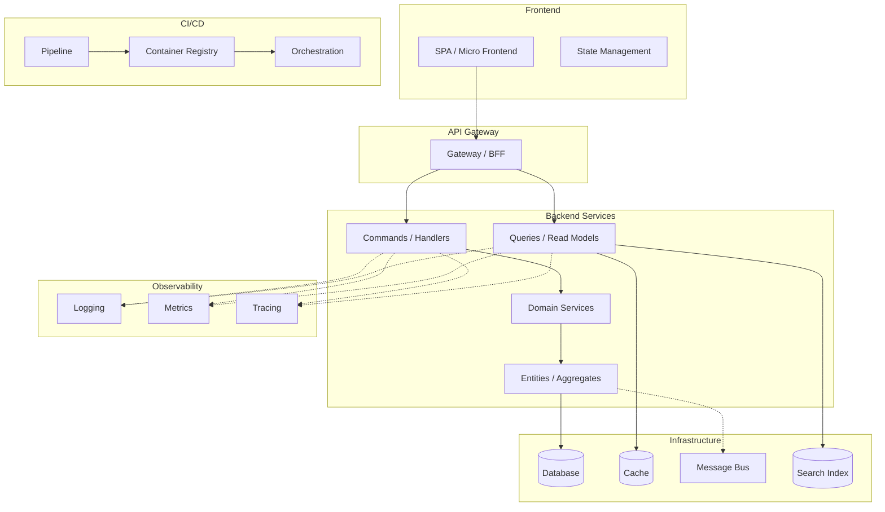

# `$architecture --mode=design` — solution architecture design reference

> Loaded by `architecture/SKILL.md`'s Mode Dispatch when invoked as `$architecture --mode=design [brief]`. Formerly `/architecture-design`. This contract is the whole invocation: run it exactly as written, standalone or as a workflow step. `$ARGUMENTS` in this file means the invocation text after `--mode=design`.

> **[BLOCKING]** Execute skill steps in declared order. NEVER skip, reorder, or merge steps without explicit user approval. Inside a workflow run, `$start-workflow` → Workflow-step mode bounds this rule.
> **[BLOCKING]** Before each step or sub-skill call, update todo tracking: set `in_progress` when step starts, set `completed` when step ends.
> **[BLOCKING]** Every completed/skipped step MUST include brief evidence or explicit skip reason.
> **[BLOCKING]** If Task tools are unavailable, create and maintain an equivalent step-by-step plan tracker with the same status transitions.

> **Architecture knowledge:** use universal laws, tactics, coupling/style trade-offs, anti-patterns, and judgment scripts; `— VERIFY` entries are hypotheses, so verify named sources (or project docs/primary sources for `[model-knowledge]`), while project-reference docs/accepted ADRs outrank conflicts.
> **MUST ATTENTION READ** `.claude/docs/architecture-knowledge.md` sections relevant to this design before recommending — why: it supplies portable reasoning, not binding project convention.
> **Foundation/scale/scenario catalogs:** derive Lifecycle/T/B/R plus runtime, T0–T3 and B0–B3 from evidence; use all seven foundation dimensions and applicability/stress matrices; unknowns use lower/assumed tiers, lean systems can PASS, and matrices are advice-only (never score/gate mutations).
> **MUST ATTENTION READ** `.claude/docs/engineering-foundation-catalog.md`, `.claude/docs/scale-technique-catalog.md`, and `.claude/docs/scenario-stress-catalog.md` before applying those gates — why: each catalog owns its profile, warranting, verdict, and drift boundary.
> **Routing/sequential/overlay protocols:** route specialized work to its matching agent; independent tasks use one-message PAR waves with all-return barriers; complex reasoning uses structured revision/branch/hypothesis checks; overlays resolve exact > glob > all, derive safe bodies, apply additively, and escalate equal-tier conflicts.
> **MUST ATTENTION READ** `.claude/skills/shared/sub-agent-selection-guide.md` and `.claude/skills/project-skill-protocol/references/registry.md` before using those protocols — why: these files own routing and overlay resolution.

## Contents

- [Quick Summary](#quick-summary)
- [First Principle — Easy to Change · Easy to Scale · Easy to Maintain](#first-principle--easy-to-change--easy-to-scale--easy-to-maintain)
- [Inputs & Handoffs (consume vs produce)](#inputs--handoffs-consume-vs-produce)
- [Step 1: Load Context](#step-1-load-context)
- [Step 2: Derive Architecture Requirements](#step-2-derive-architecture-requirements)
- [Step 3: Backend Architecture](#step-3-backend-architecture)
- [Step 3C: Data & Consistency Architecture](#step-3c-data--consistency-architecture)
- [Step 3D: Integration & API Architecture](#step-3d-integration--api-architecture)
- [Step 4: Frontend Architecture](#step-4-frontend-architecture)
- [Step 4B: UI System Architecture](#step-4b-ui-system-architecture)
- [Step 5: Library Ecosystem Research](#step-5-library-ecosystem-research)
- [Step 6: Testing Architecture](#step-6-testing-architecture)
- [Step 7: CI/CD & Deployment](#step-7-cicd--deployment)
- [Step 8: Observability & Monitoring](#step-8-observability--monitoring)
- [Step 9: Code Quality & Clean Code Enforcement](#step-9-code-quality--clean-code-enforcement)
- [Step 10: Dependency Risk Assessment](#step-10-dependency-risk-assessment)
- [Step 11: Generate Report](#step-11-generate-report)
- [Step 12: User Validation Interview](#step-12-user-validation-interview)
- [Best Practices Audit (applied across all steps)](#best-practices-audit-applied-across-all-steps)
- [Output](#output)
- [Next Steps](#next-steps)
- [Anti-Rationalization (reject these excuses)](#anti-rationalization-reject-these-excuses)
- [Mode protocols](#mode-protocols)
- [Prompt-Enhance Closing Anchors](#prompt-enhance-closing-anchors)
- [Closing Reminders](#closing-reminders)

## Quick Summary

**Goal:** Design and user-validate a complete, evidence-backed architecture decision package for all applicable backend/frontend, data, integration, deployment, observability, testing, quality, and dependency concerns—research ≥3 options, cite evidence + confidence for every recommendation, and emit ADR/Scaffold contracts—so implementation starts from sound, owned choices.
**Summary:**
- **Purpose:** fit architecture to workload, constraints, team, and risk while preserving upstream decisions and giving downstream steps an ADR-backed report plus Scaffold/Harness choices.
- **Decision gates:** choose Greenfield/Brownfield first; rank one-way doors; quantify workload/NFRs; choose ≤3 drivers + sacrifices; interrogate each irreversible choice, design it twice, then self-audit.
- **Evidence gates:** read project docs/ADRs; research ≥3 options per applicable concern; prescribe tactics before products; cite sources + confidence; complete the testability/execution matrix; get user confirmation; NEVER skip the Step-12 gate.
- **Ordered work:** 1 Context (+mode) → 2 Requirements (+workload/scaling, reversibility, NFRs, interrogation, validation; reuse a `tech-stack-research` run's requirements, or 2-3 stack comparison when a new stack dependency is unsettled) → 3A/3B backend styles/patterns → 3C data (when persistence/tenancy/consistency) → 3D integration (when a boundary exists) → 4 frontend → 4B UI (when UI exists) → 5 libraries → 6 testing → 7 delivery → 8 observability → 9 quality/Scaffold → 10 dependency risk → 11 report/ADRs → 12 ask user question tool user validation → Next Steps ask user question tool + independent council offer.

**Workflow (12 steps):**

1. **Load Context** — Read domain model, tech stack, business evaluation, refined task
2. **Derive Architecture Requirements** — Profile workload + ordered scaling ladder, rank reversibility, pick ≤3 driving attributes, quantify 6-part scenarios, run 2-2 pre-decision interrogation on every one-way door
3. **Backend Architecture** — 3A styles (selection procedure) · 3B design patterns · **3C data & consistency** · **3D integration & APIs**
4. **Frontend Architecture** — Research top 3 frontend architecture styles + design patterns
5. **Library Ecosystem Research** — Best-practice libraries per concern (validation, caching, logging, utils, etc.)
6. **Testing Architecture** — Unit, integration, E2E, performance testing frameworks + strategy
7. **CI/CD & Deployment** — Pipeline design, containerization, orchestration, IaC
8. **Observability & Monitoring** — Logging, metrics, tracing, alerting stack
9. **Code Quality & Clean Code** — Linters, analyzers, formatters, enforcement tooling
10. **Dependency Risk Assessment** — Package health, obsolescence risk, maintenance cost
11. **Generate Report** — Full architecture decision report with all recommendations
12. **User Validation** — Present findings, ask 8-12 questions, confirm all decisions

**Key Rules:**

- **AI surface?** Only if the design adds or changes a model call, agent, tool/MCP, retrieval or eval (see `node .claude/scripts/ai-signal-scan.cjs`): read `.claude/skills/shared/protocols/ai-feature-framing-gate.md` and apply it to autonomy, trust boundaries and data flow; otherwise skip this line.
- **MANDATORY IMPORTANT MUST ATTENTION** research minimum 3 options per architecture concern with web evidence
- **MANDATORY IMPORTANT MUST ATTENTION** include confidence % with evidence for every recommendation
- **MANDATORY IMPORTANT MUST ATTENTION** run user validation interview at end (never skip)
- Delegate to `solution-architect` agent for complex architecture decisions
- All claims must cite sources (URL, benchmark, case study, or codebase evidence)
- Base every recommendation on evidence, never on familiarity alone

**Be skeptical. Apply critical thinking, sequential thinking. Every claim needs traced proof, confidence percentages (Idea should be more than 80%).**

---

## First Principle — Easy to Change · Easy to Scale · Easy to Maintain

> The full gate is `SYNC:core-engineering-principles` (full body under Mode protocols below); its closing digest ends this file.

---

## Inputs & Handoffs (consume vs produce)

Skill sits mid-workflow: consume settled upstream decisions; produce named artifacts downstream steps need. NEVER re-derive upstream-owned decisions or leave consumers without their artifact — why: re-derivation wastes effort and risks divergence.

| Consumes (read, don't re-derive)                 | From                  | Produces (named deliverable)                                  | Consumed by                         |
| ------------------------------------------------ | --------------------- | ------------------------------------------------------------- | ----------------------------------- |
| Bounded contexts, aggregates, domain events, ERD | `domain-analysis`     | Architecture decision report (`{plan-dir}/research/...`)      | `plan`, `plan --mode=execute`              |
| Confirmed languages/frameworks/databases         | `tech-stack-research` | Confirmed decisions (`{plan-dir}/phase-02b-architecture.md`)  | `plan`, `scaffold`                  |
| Expected scale, compliance, budget constraints   | `business-evaluation` | Scaffold Handoff table (tooling + fitness rules)             | `scaffold`, `harness-setup`         |
| Existing stack/patterns/ADRs (brownfield)        | reference docs, ADRs under the ADR root (default `docs/adr/**`; `docsRoots.adr.path` in `docs/project-config.json` overrides) | ADRs for hard-to-reverse decisions | `architecture --mode=review` (conformance) |

If an upstream artifact is missing, capture its minimum needed input and record the gap; NEVER silently rerun full upstream analysis — why: silent reruns hide the gap the owning step must resolve.

**Stack decisions — reuse or own, one interview:**

- **`tech-stack-research` ran in this run:** reuse its confirmed requirements, context signals and per-layer option research instead of re-deriving them, citing `{plan-dir}/research/tech-stack-comparison.md` and `{plan-dir}/phase-02-tech-stack.md` (`status: confirmed`). Step 1 copies the shared signals, Step 2 confirms only the requirements that research left uncovered, Step 5 researches libraries for the confirmed stack, and Step 12 asks only the stack questions the run's decision log leaves open or new evidence reopened.
- **It did not run, and a new stack-layer dependency is in play** (a language, framework, database, messaging, infrastructure or auth choice that the project's references and ADRs have not settled): run [Step 2-3](#2-3-stack-comparison-own-phase) as this mode's own first research phase — the top 3 viable alternatives per open layer with license and cost evidence — and carry its choices into the Step 12 interview. One interview covers the stack and the architecture; never run a separate stack interview. The phase is recorded in the report, so it is an owned phase, not a silent upstream rerun.

---

## Step 1: Load Context

> **Mode (decide first):** **Greenfield** (new project, e.g. `workflow-greenfield-init`) → research every concern from scratch, 3+ options/concern. **Brownfield** (large feature in an existing codebase, e.g. `workflow-big-feature`) → FIRST read project-reference docs + accepted ADRs; constrain research to the existing stack/patterns; propose changes only where new requirements outgrow them. NEVER re-litigate a settled ADR without superseding-ADR rationale — why: re-deciding recorded choices churns code and breaks downstream conformance checks.

Read prior-step artifacts (search the plans root, default `plans/`, and the team-artifacts root, default `team-artifacts/`; `docsRoots.plans.path` / `docsRoots.teamArtifacts.path` in `docs/project-config.json` override these paths):

- Domain model / ERD (complexity, bounded contexts, aggregate count)
- Tech stack decisions (confirmed languages, frameworks, databases)
- Business evaluation (scale, constraints, compliance)
- Refined task (scope, acceptance criteria)
- Discovery interview (team skills, experience level)

When `tech-stack-research` ran in this run, take the signals it already extracted (scale, team skills, budget, compliance, real-time, integration complexity) from its report and cite it; extract only the rows it lacks.

Extract + summarize:

| Signal                  | Value        | Source           |
| ----------------------- | ------------ | ---------------- |
| Bounded contexts        | ...          | domain model     |
| Aggregate count         | ...          | domain model     |
| Cross-context events    | ...          | domain model     |
| Confirmed tech stack    | ...          | tech stack phase |
| Expected scale          | ...          | business eval    |
| Team architecture exp.  | ...          | discovery        |
| Compliance requirements | ...          | business eval    |
| Real-time needs         | Yes/No       | refined task      |
| Integration complexity  | Low/Med/High | domain model     |
| Deployment target       | ...          | business eval    |

---

## Step 2: Derive Architecture Requirements

### 2-0: Rank every decision by REVERSIBILITY (do this FIRST)

Architecture = the set of decisions **expensive to reverse**; everything cheap to reverse is design — leave it to implementers. Classify each decision BEFORE researching it, because the classification sets how much rigour it earns.

| Class | Meaning | Required treatment |
| --- | --- | --- |
| **One-way door** | Reversal costs a migration, a rewrite, or a breaking change to consumers | **ADR (Step 11) + user validation (Step 12) MANDATORY** — research 3+ options, name the rejected alternative AND the measurable revisit trigger |
| **Two-way door** | Reversal is a refactor inside one module | Decide, record one line, move on — NEVER burn a validation question on it |

**One-way doors (assume MANDATORY ADR unless proven otherwise):** data model + primary-key strategy · tenancy model · consistency model per read path · sync-vs-async at a boundary · public API/event contract · service boundary lines · cloud-primitive lock-in · auth/identity model · data residency + retention.

**MANDATORY IMPORTANT MUST ATTENTION** never treat a one-way door as a two-way door to save a step — why: an unreviewed irreversible decision is the single most expensive failure mode of this skill, and it surfaces months later as a migration.

Map signals to architecture constraints:

| Signal                      | Architecture Requirement                                  | Priority |
| --------------------------- | --------------------------------------------------------- | -------- |
| Many bounded contexts       | Clear module boundaries, context isolation                | Must     |
| High scale                  | Horizontal scaling, stateless services, caching strategy  | Must     |
| Complex domain              | Rich domain model, separation of domain from infra        | Must     |
| Cross-context events        | Event-driven communication, eventual consistency          | Must     |
| Small team                  | Low ceremony, fewer layers, convention over configuration | Should   |
| Compliance                  | Audit trail, immutable events, access control layers      | Must     |
| Real-time                   | Event sourcing or pub/sub, WebSocket/SSE support          | Should   |
| High integration complexity | Anti-corruption layers, adapter pattern, API gateway      | Should   |

### Quality-Attribute Scenarios (quantify — these drive the style choice)

Qualitative "Must/Should" cannot select a style (e.g. modular monolith vs microservices). Capture **measurable** targets; ask the user about unknowns via `ask user question tool` (assumptions require a label + confidence %). These targets become ADR budgets that `architecture --mode=review` Category 9 checks against changes — why: style without numbers is guesswork, not an enforceable decision.

| Quality attribute     | Scenario (stimulus → measurable response)                             | Target (fill in) |
| --------------------- | -------------------------------------------------------------------- | ---------------- |
| Latency               | p95 / p99 response time for the hottest read and write paths         | e.g. p99 < 300ms |
| Throughput            | Sustained req/s and peak burst the system must absorb                | e.g. 500 rps peak |
| Availability / SLO    | Target uptime and error budget                                       | e.g. 99.9%       |
| Data durability (RPO) | Max acceptable data loss on failure                                  | e.g. ≤ 5 min     |
| Recovery (RTO)        | Max acceptable time to restore service                               | e.g. ≤ 30 min    |
| Data-volume growth    | Row/document/event growth → storage, index, partition strategy       | e.g. 10M rows/yr |
| Concurrency           | Concurrent users/sessions and contention hot spots                   | e.g. 2k concurrent |
| Compliance/retention  | Regulated data, retention window, residency, audit                   | e.g. GDPR, 7yr   |
| Cost unit economics   | `$/request`, `$/tenant`, `$/MAU` — and whether unit cost RISES with scale | e.g. <$0.002/req |

Scenario template — **all SIX parts, none optional**: `[SOURCE: who/what triggers] [STIMULUS: the event] on [ARTIFACT: which component] under [ENVIRONMENT: the conditions] SHALL produce [RESPONSE] within [MEASURE: threshold + instrument]`. "Must be scalable" decides nothing; "5,000 concurrent checkout sessions at 400 rps SHALL complete p99 < 800 ms, ≤0.1% errors, verified by the CI k6 profile" selects a structure.

**MUST ATTENTION** a scenario missing SOURCE or ARTIFACT is untestable — no fitness function can target "the system" under "load"; name actor + component — why: an unattributed scenario gets no owner, test, or budget, so it silently degrades.

**Rule:** any target left unknown is explicit `Unresolved question` (Step 11), NEVER a silent omission — an architecture chosen without scale numbers is a guess, not a decision.

### Workload Profile + Scaling Ladder (MANDATORY before technique selection)

Record `read:write ratio` · sustained/peak RPS or events/s · dominant query/write shapes · dataset size + growth · payload size · burst duration · hot-key/tenant skew · user regions · latency percentile targets · consistency/staleness tolerance. For each scaling component, name the measured bottleneck removed and next bottleneck created.

| Order | Use when evidence shows | First tactic | Purchase price |
| --- | --- | --- | --- |
| 1. Measure + tune | Baseline unknown or slow path unprofiled | Query/plan analysis, indexes, batching, pooling, compression | Engineering time; lowest reversibility cost |
| 2A. Vertical scale | One node remains simplest and headroom exists | More CPU/RAM/IOPS; tune runtime/database | Hardware ceiling; remaining SPOF without redundancy |
| 2B. Horizontal app scale | Availability or aggregate compute requires replicas and the path can be stateless | Replicas + redundant load balancing + health checks | Coordination, externalized state, deployment complexity |
| 4. Read-path scale | High read ratio or global read latency | Cache/CDN/read replicas/read models | Invalidation, lag, read-your-writes, cache-key correctness |
| 5. Write-path scale | Bursty ingest or heavy work need not finish inline | Batching, durable queue + workers; LSM store for sustained write-heavy known-query workloads | Accepted ≠ completed, retries/idempotency/backpressure; compaction/read amplification |
| 6. Partition/shard | Earlier rungs proven insufficient by capacity measurements | Query-aligned partition key + reshard plan | Cross-shard queries/transactions, hotspots, hard reversal |

**MANDATORY IMPORTANT MUST ATTENTION** NEVER jump to sharding, multi-region writes, or an extra datastore without evidence that earlier rungs cannot meet the quantified target — why: these are hard-to-reverse operational systems, not generic performance upgrades.

**Move each attribute with a TACTIC, not a product.** Once a target is unmet or at risk, select the mechanism from the tactics inventory in `.claude/docs/architecture-knowledge.md` §2 (availability · performance · modifiability · security · testability · usability) — "bulkhead a pool per dependency" is a design decision; "add Kubernetes" is a shopping list. — why: the tactic is portable across stacks and makes the trade-off legible, the product imports costs nobody asked for.

### 2-1: Pick ≤3 DRIVING attributes — and name what you SACRIFICE

Quality attributes CONFLICT, and that conflict IS the architecture: consistency↔availability · latency↔durability · flexibility↔simplicity · security↔usability · cost↔redundancy · performance↔modifiability.

**MANDATORY IMPORTANT MUST ATTENTION** name at most 3 DRIVING attributes and explicitly record which attributes are being SACRIFICED to buy them — a design claiming to maximize everything has decided nothing — why: unnamed sacrifices resurface as production surprises nobody agreed to.

| Field | Record |
| --- | --- |
| Driving attributes (≤3) | ... + the quantified target for each (from the table above) |
| Explicitly sacrificed | ... + the acceptable degradation, e.g. "search may lag ≤5 s" |
| Trade-off purchased | Use the "buy this / pay with this" table in `.claude/docs/architecture-knowledge.md` §19 — state cost, never just benefit |

**Availability arithmetic (compute it, never assert it):** dependencies in a request path MULTIPLY — five 99.9% deps ⇒ ~99.5% (≈43 h/yr down). Redundancy in PARALLEL adds 9s **only when failure modes are genuinely independent**; shared config, control plane, DNS and the deploy pipeline are the usual hidden serial term. Ladder: 99% = 3.65 d/yr · 99.9% = 8.77 h · 99.95% = 4.38 h · 99.99% = 52.6 min · 99.999% = 5.26 min.

**Cost is a quality attribute, not a later phase.** Model unit economics now: architecture whose UNIT cost RISES with scale eventually fails, regardless of elegance. Major web drivers: egress + cross-AZ/cross-region traffic · idle over-provisioned compute · unbounded log/metric/trace retention/cardinality · per-request managed-service pricing at steady high volume · always-on non-prod. Serverless vs always-on **inverts with utilization** — model, never assume.

**MANDATORY IMPORTANT MUST ATTENTION** validate derived requirements with user via `ask user question tool` before proceeding.

When `tech-stack-research` confirmed requirements in this run, cite them and ask only about the requirements they leave uncovered. When this mode owns the stack phase (2-3), this one confirmation also covers the stack requirements.

### 2-2: Pre-Decision Interrogation (MANDATORY for every one-way door from 2-0)

Answer the 15-question pre-decision script in `.claude/docs/architecture-knowledge.md` §20.1 for each one-way door BEFORE researching options. Record answers in the Step 11 report; each "unknown" becomes an `Unresolved question`, never a silent gap.

The five that most often expose a wrong decision — never skip these:

| # | Question | Why it changes the answer |
| --- | --- | --- |
| 3 | Is this a one-way or two-way door, and what makes it so? | Sets how much rigour the decision earns; misclassification is this skill's most expensive failure |
| 5-6 | Expected load NOW and at 10× — and **what breaks FIRST**? | Names the actual bottleneck instead of the imagined one; 10×, never 1000× |
| 8 | What is the consistency requirement PER read path, and what staleness is acceptable? | Consistency is decided per path, never once globally |
| 14 | What existing thing could be used instead of building? | Generic subdomains (auth, billing, notifications, search) are the top source of wasted architecture budget |
| 15 | **What would have to be TRUE for this to be the WRONG choice — and how would I detect it?** | Becomes the ADR's measurable revisit trigger |

**MANDATORY IMPORTANT MUST ATTENTION** a one-way door with no answer to question 15 is a BELIEF, not a decision — NEVER emit its ADR without a named falsifier and a measurable revisit trigger. — why: with no trigger nobody ever revisits it, so the decision outlives the constraints that justified it.

### Architecture & Scalability Scorecard Inputs (feeds `architecture --mode=scalability`)

Record these decisions so init-time `architecture --mode=scalability` (`mode=init`) can grade **enforceable mechanisms, not intent**. Each row is a **design decision**, not a finding: capture the choice AND enforcement location. Unknowns become explicit `Unresolved question` (Step 11), never silent omissions — why: a scorecard can grade only decisions with an enforcement home.

| Scorecard input | Design prompt (decide + record where enforced) | Enforcement handoff |
| --------------- | ---------------------------------------------- | ------------------- |
| Build & CI scalability | As the codebase grows, how are build/CI times kept bounded? Decide **incremental** builds, changed/**affected**-only detection, local + **remote cache** strategy, and CI test/build parallelism. Name the build-system fit (single-package vs monorepo tool such as Nx / Turborepo / Bazel) **as an evaluated option**, not a default. | Step 7 (CI/CD provider parallelism + caching) |
| Horizontal scaling budgets | From the Step 2 scale targets, decide **stateless** app nodes, load balancing, caching tiers, async/queue + back-pressure, DB scale plan (sharding/partitioning/replication), connection pooling, rate limits, and a **SPOF** scan of every single-instance dependency. | ADR + Step 8 observability SLOs |
| Strategic DRY | Decide the **strategic DRY** / shared-knowledge strategy: monorepo, shared domain lib, custom platform / util lib — AND explicitly when NOT to share. Keep domain concepts OUT of generic/shared/infra layers (a shared layer coupled to one consumer's domain is no longer reusable). | Step 9 arch-rules + `scaffold` foundation |
| Dependency-boundary enforcement | Decide explicit dependency directions between modules/contexts and the mechanism that enforces them (no circular deps). | Step 9 "Arch rules / fitness" handoff → `linter-setup` |

`architecture --mode=scalability` grades these inputs at init/audit; `architecture --mode=review` catches per-change regressions. Do NOT turn this step into an auditor: record decisions here and route grading to those skills.

### 2-3: Stack Comparison (own phase)

Run this phase only when `tech-stack-research` did not run in this run and a new stack-layer dependency is in play (see [Inputs & Handoffs](#inputs--handoffs-consume-vs-produce)). Otherwise record `Stack: reused — <tech-stack-research report path>` or `Stack: settled — <reference doc or ADR>` and continue to Step 3.

1. Classify each stack layer `OPEN-REQUIRED`, `FIXED` or `N/A` with evidence; only open layers need alternatives.
2. For each open layer, compare the top 3 viable alternatives, including the current or simplest option; when constraints leave fewer, record the eliminated candidates and why. Cite evidence for license, cost (hosting and licensing), maturity and maintenance, team fit and lock-in. Set one total search cap before searching, as `tech-stack-research` Step 3 does, and stop when the decision-critical claims are supported.
3. Rank each layer with a confidence %; treat a lock-in choice as a one-way door (2-0, 2-2) and record the comparison in the Step 11 report.
4. Ask the user nothing here: the Step 2 confirmation covers the stack requirements and the Step 12 interview carries the stack choices.

---

## Step 3: Backend Architecture

### 3A: Architecture Styles

WebSearch top 3 backend architecture styles. Candidates:

| Style                       | Best For                                 | Research Focus                            |
| --------------------------- | ---------------------------------------- | ----------------------------------------- |
| **Clean Architecture**      | Complex domains, long-lived projects     | Dependency rule, testability, flexibility |
| **Hexagonal (Ports+Adapt)** | Integration-heavy, multiple I/O adapters | Port contracts, adapter isolation         |
| **Vertical Slice**          | Feature-focused teams, rapid delivery    | Slice isolation, code locality            |
| **Modular Monolith**        | Starting simple, eventual decomposition  | Module boundaries, migration path         |
| **Microservices**           | Large teams, independent deployment      | Service boundaries, operational overhead  |
| **CQRS + Event Sourcing**   | Audit-heavy, complex queries             | Read/write separation, event store        |
| **Layered (N-Tier)**        | Simple CRUD, small teams                 | Layer responsibilities, coupling risk     |

Full 16-style matrix (*buys / costs / choose-when / avoid-when*) → `.claude/docs/architecture-knowledge.md` §5.

#### Style selection procedure (MANDATORY order — never shortcut)

1. Take the ≤3 quantified driving attributes from Step 2-1.
2. **ELIMINATE** every style that cannot meet them (state which attribute eliminated it).
3. **DESIGN IT TWICE** — produce ≥2 MATERIALLY different surviving candidate designs (not two spellings of one idea) and write what each SACRIFICES. — why: committing to the first idea that occurred to you is the most common architecture failure and the one nobody records; a second real candidate is what makes the first one a choice.
4. Among survivors take the **SIMPLEST** — not the most capable.
5. Emit an ADR (Step 11) naming the rejected alternative AND the **measurable trigger** that would revisit the choice.

**MANDATORY IMPORTANT MUST ATTENTION** design-it-twice applies to EVERY one-way door from 2-0, not only the style choice — data model, tenancy model, consistency model per read path, sync-vs-async at a boundary. NEVER emit a one-way-door ADR whose "Alternatives considered" section was written to justify a decision already made. — why: a retrofitted alternative is advocacy, not evaluation, and it hides the sacrifice the reviewer needs to see.

Styles COMPOSE when their responsibilities fit together—for example, a modular application may use asynchronous integration at selected boundaries. Do not prescribe a service count or combination in advance; select each boundary from workload, consistency, ownership, deployment, and operational evidence.

**Greenfield default, when it fits:** For a new business application with one release boundary and no measured need for independent deployment, scaling, compliance, availability, or runtime, prefer a modular monolith. Give important modules explicit contracts and dependency direction; add automated boundary checks when the chosen stack can enforce them economically. This is a starting hypothesis, not a framework mandate: record the evidence when another architecture is a better fit. For brownfield work, follow the existing architecture and accepted ADRs unless a requirement justifies an explicitly reviewed migration. An existing service platform, independently operated capabilities, serverless/event workloads, or other deployment constraints may justify starting with distributed components.

| Evidence that may justify a separate deployable boundary | Weak justification by itself |
| --- | --- |
| Repeated, measured scaling or resource profiles that materially diverge | "The codebase feels big" |
| A distinct compliance, data-residency, availability, or fault-isolation boundary | "Microservices are best practice" |
| Independent ownership/release is blocked by a shared deploy and the coordination cost is evidenced | A resume, a conference talk, or framework support |
| A genuinely different runtime or platform requirement | A new team was hired |
| A bounded capability has an explicit contract and can tolerate its data/consistency boundary | The domain has many entities |

Before recommending a distributed design, assess the operating model that would support it: deployment automation, infrastructure management, observability/tracing, incident ownership, and recovery practices. Missing capabilities are risks and migration work to name; they do not automatically disqualify a design required by the workload or platform.

**MUST ATTENTION** draw boundaries around **capabilities/behaviors** (`Checkout`, `Fulfilment`, `Pricing`), NEVER around **nouns/data** (`UserService`, `ProductService`). Entity-per-service guarantees every real use case must synchronously traverse many services — a distributed monolith produced by design. The unit of extraction is the **bounded context**, not the entity.

### 3B: Backend Design Patterns

Evaluate applicability per layer:

| Pattern             | Concern / boundary | When to consider it                                                                 |
| ------------------- | ------------------ | ----------------------------------------------------------------------------------- |
| **Repository**      | Persistence        | A useful domain/query contract, test seam, or persistence-change boundary exists   |
| **CQRS**            | Read/write paths   | Read and write models have materially different needs                              |
| **Mediator**        | In-process dispatch| The project uses this idiom or it removes real caller/handler coupling              |
| **Strategy**        | Variable behavior  | Multiple real algorithms must be selected or replaced                              |
| **Observer/Events** | Reactions          | Independent reactions or async decoupling are valuable and their failure model is owned |
| **Factory**         | Construction       | Creation enforces meaningful invariants or hides non-trivial assembly               |
| **Decorator**       | Cross-cutting      | A capability can be composed around an implementation without hiding behavior       |
| **Adapter**         | External boundary  | An external dependency or protocol needs translation or isolation                    |
| **Specification**   | Business/query rules | Rules genuinely compose or need a named, reusable query contract                  |
| **Unit of Work**    | Transactions       | A use case must coordinate a transaction across persistence operations              |
| **Saga/Orchestr.**  | Distributed work   | A business process spans owners and has explicit compensation/recovery semantics   |
| **Outbox**          | Durable messaging  | A committed database change and durable message publication must agree atomically  |
| **Circuit Breaker** | Remote dependency  | A failing/slow dependency needs bounded calls and recovery behavior                 |

For each recommended pattern, document **Apply to**, **Why**, **Example**, and **Risk if skipped**.

**MUST ATTENTION** patterns are a VOCABULARY for a solution you already need, never a menu to shop from — applying patterns to demonstrate knowledge produces the *gas factory* anti-pattern. The right number of patterns is the SMALLEST number that removes a DEMONSTRATED pain. Watch the chronically over-applied ones: Singleton (global mutable state → prefer one DI registration), Service Locator (hides dependencies from compiler and tests), CQRS on simple CRUD, event sourcing used as an audit log (an audit table is the right answer).

**Purpose-oriented abstraction naming gate:** Name ports, interfaces, modules, APIs, and adapters by the capability or domain contract consumers rely on; keep provider, SDK, framework, database, and transport details on concrete implementations (`IStorage`/`Storage` → `AzureBlobStorage`). Check the proposed name against callers and all implementations, use a narrower name when the contract is narrower, preserve local interface syntax, and require an evidenced boundary/substitution need before adding an abstraction.

---

## Step 3C: Data & Consistency Architecture

> **Skip if:** no persisted state, consistency boundary, or tenant-scoped data. Otherwise evaluate applicable decisions; a row for another storage model is `NOT-APPLICABLE`, not an implementation mandate.

Data can outlive services and teams, so assess reversibility and migration cost carefully. Rank each decision using Step 2-0: high-cost choices need an ADR and Step-12 validation; ordinary or reversible choices need only the evidence and brief record useful to the project.

| Decision | Decide + record | Failure if skipped |
| --- | --- | --- |
| **Store per access pattern** | Pick each store from the ACCESS PATTERN, consistency needs, operating model, and team capability: relational (relations/transactions/flexible queries — a strong default when these matter) · document (aggregate-shaped reads) · key-value (lookup/session) · wide-column (high-volume writes with known query shapes) · graph (traversal) · time-series (append + rollups) · search (relevance/facets) · vector (semantic/ANN) · columnar (aggregation scans) · object storage (blobs). Justify each additional store against its operational and consistency costs. | Golden-hammer: the wrong store makes dominant operations expensive or hard to evolve |
| **Data ownership** | Name the owner and write contract for each important dataset. At independent service boundaries, prefer one owning writer and explicit read contracts; inside one application, shared physical storage is acceptable when module ownership/access are explicit. | Hidden multi-writer ownership makes invariants and change impact unclear |
| **Persistence boundary** | Across independently operated services, prefer an explicit API/event/data contract over direct mutation of another service's private tables. Within a monolith, follow its chosen module and persistence rules; a shared database is not itself a violation. | Private-table coupling makes independent change or deployment unsafe |
| **Consistency model per read path** | Per read path choose strong / causal / **session guarantees** (read-your-writes, monotonic reads) / eventual — and write the **STALENESS BUDGET** ("search index may lag ≤5 s") as a monitored SLI (Step 8). | Unbounded, unmeasured lag IS the defect. Most user-visible "consistency bugs" are missing read-your-writes from a lagging replica, NOT missing linearizability |
| **Replication + failover semantics** | Name topology (single-primary/read replicas, quorum, or multi-primary), write acknowledgement, sync vs async replicas, failover authority, conflict policy, and RPO/RTO. Route lag-sensitive/read-after-write reads to the primary or use a version/sticky-read guarantee. | Replicas improve read capacity/availability, not write capacity; async failover can lose acknowledged writes, sync raises latency/lowers availability, multi-primary creates conflicts |
| **Transactional isolation + invariant protection** | For relational transactions on critical write paths, verify the selected engine's actual isolation guarantees and protect each check-then-act invariant with an appropriate constraint, lock, serializable retry, or atomic conditional write. For other stores, use the equivalent conditional-write, version, compare-and-set, or transaction contract. Do not prescribe SQL isolation to a non-relational store. Full relational anomaly discussion → `.claude/docs/architecture-knowledge.md` §8. | Concurrency assumptions can corrupt state or silently lose updates |
| **Storage engine + index strategy** | For relational stores, choose engine/index structures from measured access patterns; confirm plans, write costs, durability settings, and pool limits against that engine. For other stores, inspect their partition/index/query model and consistency/latency costs. | A storage configuration mismatched to dominant operations makes them expensive or unreliable |
| **Storage substrate** | Block storage for database/filesystem volumes needing low-latency random I/O · object storage for blobs/media/backups/log archives and cheap durable scale · shared file storage only when filesystem semantics are required. Record lifecycle tiering, access frequency, object size, durability, egress and mutation pattern. | "User data uses block storage" confuses application model with physical substrate; large immutable blobs in the transactional database inflate backup, replication and query costs |
| **Distributed lock / leader election — fencing** | If any flow takes a distributed lock or elects a leader, name the **fencing token** (monotonic, rejected by the storage layer when stale), the lease duration, and the behaviour when the lease expires mid-operation. Consensus (Raft/Paxos) needs a MAJORITY — a 2-node or even-sized cluster buys nothing — and stays OFF the hot path. **NEVER order distributed events, compute expiry, or resolve conflicts by wall clock** — use versions/sequences, logical/vector clocks, or HLC. | An unfenced lock fails exactly once — under a GC/VM pause, at peak, writing corrupted state — and looks correct in every test (split brain) |
| **Transaction / consistency boundary** | Define the smallest boundary that can enforce each invariant. If using DDD aggregates, keep their invariants and transaction scope cohesive; across owners, choose synchronous coordination or an eventual workflow with explicit user-visible recovery. | Boundaries that are too broad increase contention; boundaries that are too narrow cannot protect invariants |
| **Cross-boundary transaction mechanism** | When one business outcome spans independently committed owners, compare local transaction, saga/compensation, reservation/TCC, or supported distributed transaction options against the consistency and recovery requirement. Compensations are business decisions, not generic rollbacks. | Partial completion becomes an undocumented or unrecoverable business state |
| **Tenancy model** | Only for multi-tenant products: compare shared, schema/database-per-tenant, or hybrid isolation using threat, compliance, scale, operations, and cost requirements. Shared schema with database enforcement is a common SaaS option when the chosen store supports it, not a universal default. | A late tenancy decision may force a major migration or leave isolation requirements unmet |
| **Tenant isolation ENFORCEMENT** | In a pooled model, name the LOWEST-layer mechanism: database **row-level security**, an ORM global filter/interceptor, or a mandatory repository base injecting tenant from the **authenticated principal** — plus a test asserting cross-tenant reads return zero rows (Step 6 + Step 9 fitness rule). **NEVER take `tenant_id` from a client-supplied field.** | One missing `WHERE tenant_id = ?` is a cross-tenant breach that passes every functional test |
| **Keys & partitioning** | Choose identifiers and partition keys for the project's store, access patterns, security, ordering, and migration needs. Do not expose enumerable identifiers where that leaks sensitive information; choose ordered IDs only when they improve the selected store's workload. Partitioning is warranted by measured volume/hotspots, not by scale speculation. | Hot partitions, public enumeration, or premature complexity |
| **Operational and analytical workloads** | If analytical queries threaten interactive/transactional workloads, isolate them through a replica, CDC, warehouse, or another measured design. A small system may safely share a store until evidence warrants separation. | Reports may contend with production traffic or an unnecessary second platform adds cost |
| **Denormalization / caching as a PURCHASE** | For each copy/cache, name authoritative source · policy (cache-aside/read-through/write-through/write-behind/refresh-ahead) · invalidation (TTL+jitter/event/versioned key/purge) · consistency window · max size/eviction. Design stampede/hot-key/cold-start protection (single-flight, early refresh, warm-up, LB slow-start). **NEVER cache authorization decisions or tenant data under a key omitting identity/tenant/permission.** | Stale data, stampedes and hot keys move rather than remove load; cache-key omission leaks tenants; an unbounded cache OOMs; a system correct only while cache is warm has made an undocumented source of truth |
| **Migration strategy** | For rolling/overlapping deployments, prefer compatible expand–contract steps and safe retries. For coordinated downtime or disposable data, choose a simpler migration if its rollback and recovery story is sound. Check lock duration and backfill impact on large stores. | An incompatible migration can break old/new versions during rollout or make rollback unsafe |
| **Lifecycle: classification, retention, residency, deletion** | Classify (PII/PHI/PCI/public), set retention + archival tiering + deletion (GDPR/CCPA erasure) + residency NOW. | Retrofitting deletion into an event-sourced or heavily-denormalized system is brutally expensive — and erasure conflicts with immutable event stores by design |
| **RPO / RTO per dataset** | Set them PER DATASET (they drive topology and cost) and schedule a **restore drill**. | "We have backups" is a hypothesis; an undrilled DR plan has an RTO of "unknown" |

For each applicable data decision, use Step 2-0 to decide whether an ADR/user validation is warranted. Store, tenancy, consistency, or key choices are one-way doors only when the actual migration or compatibility cost makes them hard to reverse; do not invent tenant, relational, or sharding architecture when the project does not need it.

---

## Step 3D: Integration & API Architecture

> **Skip if:** no boundary is crossed — no external consumer, second service, message bus, or third-party integration. Otherwise MANDATORY.

| Decision | Decide + record | Failure if skipped |
| --- | --- | --- |
| **Sync vs async per boundary** | **Synchronous** only when the caller genuinely cannot proceed without the answer (user-awaited QUERIES). **Asynchronous** for EFFECTS (notification, fan-out, work completable later). A sync chain deeper than 2-3 hops is an availability + latency defect — flatten, cache, or make it an event. | Sync chains MULTIPLY availability (five 99.9% deps ⇒ 99.5%) and SUM latency |
| **Async acceptance contract** | When work moves behind a queue, define the public state machine: `accepted` (`202`/job ID) → pending/running/succeeded/failed/cancelled; status lookup or callback; retry visibility; terminal failure ownership. User feedback MUST say accepted, not completed. | Fast acknowledgement without completion semantics creates false success, invisible backlog, and unrecoverable business ambiguity |
| **API style per consumer** | REST/HTTP+JSON (public, broad compat, HTTP caching) · GraphQL (client-driven queries, aggregation — needs depth/complexity limits + persisted queries + dataloader or it becomes a DoS and N+1 surface) · gRPC (low-latency internal, streaming, codegen) · webhooks (push to third parties — needs retries + signature verification) · WebSocket/SSE (real-time; SSE when one-way suffices). | Wrong style makes the dominant interaction chatty or uncacheable |
| **Versioning + deprecation policy** | For independently released APIs with external or independently deployed consumers, define compatibility/versioning and deprecation from the first contract. Version the contract, not every field; select URL/header/schema versioning and support windows from consumer needs. A lockstep internal interface may need compatibility tests without a public version scheme. | Unplanned contract changes can break consumers and make usage hard to discover |
| **Contract-first + contract tests in CI** | For independently deployed producers/consumers, choose a contract format that fits the protocol (for example OpenAPI, protobuf, or AsyncAPI) and test compatibility in CI. Use the project's actual schema/contract tooling; do not add consumer-driven tooling to a lockstep boundary without a need. | Without a visible contract and compatibility check, independent releases can break consumers |
| **Write-then-publish consistency** | When durable publication must agree atomically with a database transaction, use a transactional outbox, CDC, or a supported equivalent; do not use two uncoordinated writes for that guarantee. A best-effort local notification can use a simpler contract. | A partial failure can leave stored state and downstream messages inconsistent |
| **Retry, deduplication, and idempotency** | For operations that may be retried, repeated, or delivered at least once, define idempotency keys, deduplication, or naturally idempotent state transitions. Scope key/result retention to the actual retry contract; use versions/sequences if ordering matters. | Retries or duplicates can repeat externally visible side effects |
| **Message taxonomy — never conflate** | **Command** ("do this", one handler, may be rejected) vs **Event/fact** ("this happened", 0..N subscribers, cannot be rejected) vs query vs document message. An "event" with exactly one permitted consumer that MUST handle it, whose failure means the flow failed, is a **COMMAND in an event costume** — name it a command and own the coupling honestly. | You pay async debugging difficulty AND keep sync coupling |
| **Event granularity per stream** | Deliberate choice: thin/notification (ID only — restores temporal coupling + read load) vs fat/state-transfer (self-contained, leaks more model, bigger payloads) vs hybrid (thin event + queryable snapshot endpoint). **NEVER leak raw DB rows as events** — CDC without a mapping layer publishes your internal schema as a frozen public contract (Hyrum). | Consumers become coupled to columns you can then never rename |
| **Schema evolution** | Versioned, registered, backward-compatible event schemas with a CI compatibility check. In event sourcing, event schemas are public contracts **forever**. | One producer change silently breaks every consumer |
| **Broker semantics — ordering, replay, durability** | Decide the three properties BEFORE naming a vendor: required **ordering scope** (global / per-entity-key / none) · required **replay window** (queue = consume-and-gone; log = offset-based replay by many consumer groups) · **durability acknowledgement** (replication factor + min-in-sync-replicas + producer acks — `acks=1` accepts data loss on leader failure, and `acks=all` waits for the replicas CURRENTLY in the ISR — so `min.insync=1` still waits for a healthy 3-replica ISR but silently degrades to `acks=1` durability once the ISR shrinks to the leader alone). Log partition count is hard to raise without rekeying, and ordering on a key costs parallelism on that key. Health SLI: queue depth + oldest-message age, or **consumer lag** for a log. | Vendor picked first ⇒ the one property you actually needed (ordering, replay, or durability) turns out to be the one that is expensive to change |
| **Load balancing + rate limiting** | When the deployment or threat model needs them, choose from measured request cost, burst shape, affinity, protected resource, and availability targets. For rate limits, select token bucket, sliding window, or concurrency/in-flight limits to fit the policy; define the protected identity/dimension and distributed-counter trade-off. | A mismatched algorithm can overload a resource or block legitimate work; unnecessary infrastructure adds latency and failure modes |
| **Queue hygiene** | **Bounded** queues + DLQ + a redrive procedure + DLQ-depth alerting; capped exponential backoff **with jitter**; poison-message handling. | An unbounded queue converts a throughput problem into unbounded latency then OOM; a DLQ nobody watches is data loss with extra steps; unjittered retries synchronize into a thundering herd |
| **Resilience config on EVERY outbound call** | Timeout (derived from the caller's remaining budget) on every network call, lock and query · capped jittered retries for idempotent ops ONLY · retry BUDGET as a % of traffic · circuit breaker with a defined fallback · bulkheads per dependency/tenant · load shedding at the edge by priority. | **A missing timeout is the single most common resilience defect**; retry amplification turns a blip into an outage. The dangerous failure is SLOW, not down — it exhausts your resources while looking healthy |
| **Graceful degradation per feature** | Pre-decide the degraded mode per feature (stale data / hide module / read-only) — a PRODUCT decision, made now, not during the incident. | Undesigned degradation becomes a total outage |
| **Trust boundary rules** | Validate at the boundary (allow-list); **NEVER trust client-supplied authorization data** — IDs, roles, prices, tenant IDs come from the authenticated principal. Machine-readable error contract (stable `code`, `message`, `details`, `traceId`; RFC 9457 problem+json is a good default) — NEVER leak stack traces. Propagate a correlation/trace ID through EVERY hop including async. | Broken access control is the #1 real-world risk; untraceable async hops make incidents unexplainable |
| **Edge component responsibilities** | Gateway = TLS, routing, authn, rate limiting, quotas, versioning — **NEVER business logic**. CDN/edge = static + deliberately cacheable dynamic content; record push/pull origin strategy, `Cache-Control`, `Vary`/cache-key dimensions, TTL and purge/versioning. BFF only when a client genuinely needs owned aggregation; skip with one client or when GraphQL fills the role. | Smart gateways duplicate domain rules; careless edge caching serves stale or personalized data to the wrong audience; missing cache policy shifts global latency/load back to origin |

**MANDATORY IMPORTANT MUST ATTENTION** every sync-vs-async choice at a boundary and every public API/event contract is a one-way door — ADR + Step-12 validation, no exceptions — why: consumers you cannot see will depend on both, and Hyrum's Law makes every observable behavior a contract you must then keep.

---

## Step 4: Frontend Architecture

### 4A: Architecture Styles

WebSearch top 3 frontend architecture styles. Candidates:

| Style                       | Best For                                    | Research Focus                            |
| --------------------------- | ------------------------------------------- | ----------------------------------------- |
| **MVVM**                    | Data-binding heavy, forms-over-data apps    | ViewModel responsibility, two-way binding |
| **MVC**                     | Server-rendered, traditional web apps       | Controller routing, view separation       |
| **Component Architecture**  | Configured SPA/component framework          | Component isolation, props/events, reuse  |
| **Reactive Store (Redux)**  | Complex state, multi-component sync         | Single source of truth, immutable state   |
| **Signal-based Reactivity** | Fine-grained reactivity in frameworks that support signals | Granular updates without broad change detection |
| **Micro Frontends**         | Multiple teams, independent deployment      | Module federation, routing, shared state  |
| **Feature-based Modules**   | Large monolith SPA, lazy loading            | Feature boundaries, route-level splitting |
| **Server Components (RSC)** | SEO, initial load performance               | Server/client boundary, streaming         |

### 4B: Frontend Design Patterns

| Pattern                      | Layer       | When to Apply                                    |
| ---------------------------- | ----------- | ------------------------------------------------ |
| **Container/Presentational** | Component   | Separate logic from UI rendering                 |
| **Reactive Store**           | State       | Centralized state, cross-component communication |
| **Facade Service**           | Service     | Simplify complex API interactions                |
| **Adapter/Mapper**           | Data        | Transform API response to view model             |
| **Observer (RxJS)**          | Async       | Event streams, real-time data, debounce/throttle |
| **Strategy (renderers)**     | UI          | Conditional rendering strategies per entity type |
| **Composite (components)**   | UI          | Tree structures, recursive components            |
| **Command (undo/redo)**      | UX          | Form wizards, canvas editors, undoable actions   |
| **Lazy Loading**             | Performance | Route/module-level code splitting                |
| **Virtual Scrolling**        | Performance | Large lists, infinite scroll                     |

---

## Step 4B: UI System Architecture

> **Skip if:** Backend-only project, no frontend component.

Research and recommend design-system architecture; ask the user each decision via `ask user question tool`.

### 4B-1: Styling Approach

WebSearch top 3 styling approaches for confirmed frontend framework:

| Approach                         | Best For                                 | Research Focus                     |
| -------------------------------- | ---------------------------------------- | ---------------------------------- |
| **Utility-first (Tailwind CSS)** | Rapid prototyping, design enforcement    | JIT, custom config, design tokens  |
| **CSS Modules / Scoped CSS**     | Component isolation, no global conflicts | Naming, composition patterns       |
| **SCSS/SASS with BEM**           | Complex theming, token variables         | BEM methodology, mixin libraries   |
| **CSS-in-JS**                    | Dynamic styling, theme providers         | Runtime perf, SSR support          |
| **CSS Custom Properties**        | Native theming, framework-agnostic       | Browser support, fallback strategy |

### 4B-2: Design Token Strategy

| Decision         | Options                                                   | Default               |
| ---------------- | --------------------------------------------------------- | --------------------- |
| Token format     | CSS custom properties / JSON / SCSS variables             | CSS custom properties |
| Token categories | Color, spacing, typography, breakpoints, shadows, z-index | All                   |
| Token naming     | Semantic (`--color-primary`) vs Functional (`--btn-bg`)   | Semantic first        |
| Theming          | Light/dark toggle / Multi-brand / Single theme            | Single + dark mode    |

### 4B-3: Component Library Strategy

| Decision        | Options                                                                     | Default                    |
| --------------- | --------------------------------------------------------------------------- | -------------------------- |
| Library         | Build custom / Headless (Radix, Headless UI) / Full kit (MUI, Ant, PrimeNG) | Based on team and timeline |
| Component tiers | Common → Domain-Shared → Page (per ui-wireframe-protocol)                   | Standard 3-tier            |
| Documentation   | Storybook / Docusaurus / In-code only                                       | Based on team size         |

### 4B-4: Responsive Strategy

| Decision    | Options                                 | Default            |
| ----------- | --------------------------------------- | ------------------ |
| Approach    | Mobile-first / Desktop-first / Adaptive | Mobile-first       |
| Breakpoints | 320/768/1024/1280 / Custom              | Standard           |
| Grid system | CSS Grid / Flexbox / Framework grid     | CSS Grid + Flexbox |

**MANDATORY IMPORTANT MUST ATTENTION** validate all UI system decisions with user via `ask user question tool` before proceeding to Step 5.

---

## Step 5: Library Ecosystem Research

For each concern below, WebSearch top 3 library options for the confirmed stack. Evaluate maturity, community, bundle size, maintenance, license, and learning curve.

> **MUST ATTENTION** never recommend a library from familiarity alone — every pick needs cited evidence (stars, release date, downloads, CVE scan). — why: familiarity bias ships unmaintained or insecure dependencies.

### Library Concerns Checklist

| Concern                     | What to Research                                            | Evaluation Criteria                            |
| --------------------------- | ----------------------------------------------------------- | ---------------------------------------------- |
| **Validation**              | Input validation, schema validation, form validation        | Type safety, composability, error messages     |
| **HTTP Client / API Layer** | REST client, GraphQL client, API code generation            | Interceptors, retry, caching, type generation  |
| **State Management**        | Global store, local state, server state caching             | DevTools, SSR support, bundle size             |
| **Utilities / Helpers**     | Date/time, collections, deep clone, string manipulation     | Tree-shakability, size, native alternatives    |
| **Caching**                 | In-memory cache, distributed cache, HTTP cache, query cache | TTL, invalidation, persistence                 |
| **Logging**                 | Structured logging, log levels, log aggregation             | Structured output, transports, performance     |
| **Error Handling**          | Global error boundary, error tracking, crash reporting      | Source maps, breadcrumbs, alerting integration |
| **Authentication / AuthZ**  | JWT, OAuth, RBAC/ABAC, session management                   | Standards compliance, SSO, token refresh       |
| **File Upload / Storage**   | Multipart upload, cloud storage SDK, image processing       | Streaming, resumable, size limits              |
| **Real-time**               | WebSocket, SSE, SignalR, Socket.io                          | Reconnection, scaling, protocol support        |
| **Internationalization**    | i18n, l10n, pluralization, date/number formatting           | ICU support, lazy loading, extraction tools    |
| **PDF / Export**            | PDF generation, Excel export, CSV                           | Server-side vs client-side, template support   |

### Per-Library Evaluation Template

```markdown
### {Concern}: Top 3 Options

| Criteria         | Option A          | Option B | Option C |
| ---------------- | ----------------- | -------- | -------- |
| GitHub Stars     | ...               | ...      | ...      |
| Last Release     | ...               | ...      | ...      |
| Bundle Size      | ...               | ...      | ...      |
| Weekly Downloads | ...               | ...      | ...      |
| License          | ...               | ...      | ...      |
| Maintenance      | Active/Slow/Stale | ...      | ...      |
| Learning Curve   | Low/Med/High      | ...      | ...      |

**Recommendation:** {Option} — Confidence: {X}%
```

---

## Step 6: Testing Architecture

Research testing tools and strategy for the confirmed stack:

| Testing Layer           | What to Research                                  | Top Candidates to Compare                    |
| ----------------------- | ------------------------------------------------- | -------------------------------------------- |
| **Unit Testing**        | Test runner, assertion library, mocking framework | Repository's configured unit-test stack       |
| **Integration Testing** | API testing, DB testing, service testing          | Supertest, TestContainers, WebAppFactory     |
| **E2E Testing**         | Browser automation, BDD, visual regression        | Playwright/Cypress/Selenium, SpecFlow        |
| **Performance Testing** | Load testing, stress testing, benchmarking        | k6/Artillery/JMeter/NBomber, BenchmarkDotNet |
| **Contract Testing**    | API contract validation between services          | Pact, Dredd, Spectral                        |
| **Mutation Testing**    | Test quality validation                           | Stryker, PITest                              |
| **Coverage**            | Code coverage collection, reporting, enforcement  | Istanbul/Coverlet, SonarQube                 |
| **Test Data**           | Factories, fixtures, seeders, fakers              | Bogus/AutoFixture/Faker.js                   |

### Test Strategy Template

```markdown
### Test Pyramid

- **Unit (70%):** {framework} — {what to test}
- **Integration (20%):** {framework} — {what to test}
- **E2E (10%):** {framework} — {what to test}

### Test-Strength Targets

- Line coverage (diagnostic only — NEVER fail the build on a coverage %): Unit: {X}% | Integration: {X}% | E2E: critical paths only
- Gate: mutation score ({tool}) in CI pipeline — fail build on surviving mutants / mutation-score regression, not on a line-coverage %
```

### Testability & Execution Contract (required architecture output)

Complete this owner-owned matrix in the architecture report before Step 6 ends. Use confirmed stack/config evidence; candidate tools are options, not proof.

| Tier | Applicability + evidence | Owner | Runner/framework + config | Test root | Data/fixture policy | Full command (host) | Full command (container) | Environment reach | Focused/partial command | Zero-match behavior | CI gate | Simple Windows/macOS/Linux entry point | Repeat proof |
| --- | --- | --- | --- | --- | --- | --- | --- | --- | --- | --- | --- | --- | --- |
| Unit | `APPLICABLE` / `N/A — {evidence}` | {owner} | {runner + config path} | {root} | {fixture/factory policy} | `{copy-ready command}` | `{copy-ready command}` / `N/A — {evidence}` | {local · CI · prod-shaped} | `{copy-ready filter}` | `{invalid/zero-match exit}` | {gate} | `{simple cross-OS command, or .cmd + .sh pair}` | `{two-run evidence or planned owner}` |
| Integration/System | `APPLICABLE` / `N/A — {evidence}` | {owner} | {runner + config path} | {root} | {public-path setup + data policy} | `{copy-ready command}` | `{copy-ready command}` / `N/A — {evidence}` | {local · CI · prod-shaped} | `{copy-ready filter}` | `{invalid/zero-match exit}` | {gate} | `{simple cross-OS command, or .cmd + .sh pair}` | `{two no-reset runs}` |
| E2E | `APPLICABLE` / `N/A — {config/source evidence}` | {owner} | {configured browser runner + config} | {root} | {reachable journey data} | `{configured command}` | `{configured command}` / `N/A — {evidence}` | {local · CI · prod-shaped} | `{configured filter}` | `{invalid/zero-match exit}` | {gate} | `{simple cross-OS command, or .cmd + .sh pair}` | `{two-run evidence or N/A}` |
| Performance/Scale | `APPLICABLE` / `N/A — {B/T-tier evidence}` | {owner} | {load/benchmark runner + config} | {root} | {volume AND shape: distribution, cardinality, skew — plus the ≥2 volumes ~10× apart} | `{copy-ready command}` | `{copy-ready command}` / `N/A — {evidence}` | {local · CI · prod-shaped} | `{single-scenario filter}` | `{invalid/zero-match exit}` | {budgets that FAIL the run} | `{simple cross-OS command, or .cmd + .sh pair}` | `{two-run evidence or planned owner}` |

- `APPLICABLE` requires a verified runner, framework, configuration, root, and command. For E2E, use `N/A — {evidence}` when no browser framework/configuration/command is verified; never turn the candidate list above into an invented stack.
- Record full/focused commands as copy-ready, with explicit scope/filter and non-zero invalid/zero-match behavior. Data/fixture and repeat columns must name unique run/test identity + business suffix, supported public setup path, realistic valid data, count-before-create idempotent/restart-safe reference setup, additive persistent-data policy, mutable-root/worker isolation, real pacing/arrange barrier, exact result, and two consecutive no-reset full runs for each applicable persistent-state integration suite (one fresh green full run for other tiers). If implementation is downstream, mark repeat proof `planned` with its owner, not PASS.

- **Host vs container commands (both columns, per tier).** Fill BOTH when the project supports both run modes, driven from ONE source of truth for config and topology; record `N/A — {evidence}` when a mode genuinely does not apply (a tier needing a real device or host GPU, or a deliberately container-only project). Name which mode CI exercises — an unexercised mode rots silently, and a **claimed-but-rotten** mode is worse than one never claimed.
- **Environment reach (per tier).** Which of local / CI / production-shaped this tier can target. The SAME suite must reach each one **parameterized by configuration, never by a forked copy of the test code** — only one fork ever stays maintained. A target missing a required capability reports `ENVIRONMENT-BLOCKED`, never a silent pass; anything unsafe against production is excluded by an ENFORCED mechanism, so *"prod reach"* means a safe, declared, **NON-MUTATING** subset.
- **Performance/Scale tier.** `APPLICABLE` at `T1+`/`B2+`; at `T0`/`B0` record `N/A — {evidence}` with the largest expected volume and one documented manual check instead. Its CI gate must be **budgets that FAIL the run** — a perf job that only reports numbers is a dashboard, and eventually nobody reads it. Its data policy must name realistic **shape** (distribution, cardinality, skew), not just a row count, and the ≥2 volumes ~10× apart that make a super-linear curve visible.

The completed matrix is the testability decision downstream scaffold and harness setup consume; do not defer tier decisions to implementation. Full run-mode, environment-reach, and volume rationale → `SYNC:engineering-foundation-gate` **F2/F3/F5** and `.claude/docs/engineering-foundation-catalog.md`.

---

## Step 7: CI/CD & Deployment

Research deployment architecture and CI/CD tooling:

| Concern                 | What to Research                                     | Top Candidates to Compare                     |
| ----------------------- | ---------------------------------------------------- | --------------------------------------------- |
| **CI/CD Provider**      | Pipeline orchestration, parallelism, caching         | Repository's configured CI/CD tooling          |
| **Containerization**    | Container runtime, image building, registry          | Docker/Podman, BuildKit, ACR/ECR/GHCR         |
| **Orchestration**       | Container orchestration, service mesh, scaling       | Kubernetes/Docker Compose/ECS/Nomad           |
| **IaC (Infra as Code)** | Infrastructure provisioning, drift detection         | Terraform/Pulumi/Bicep/CDK                    |
| **Artifact Management** | Package registry, versioning, vulnerability scanning | NuGet/npm/Artifactory/GitHub Packages         |
| **Feature Flags**       | Progressive rollout, A/B testing, kill switches      | LaunchDarkly/Unleash/Flagsmith                |
| **Secret Management**   | Vault, key rotation, environment variables           | Azure KeyVault/HashiCorp Vault/SOPS           |
| **Database Migration**  | Schema versioning, rollback, seed data               | EF Migrations/Flyway/Liquibase/dbmate         |

### Deployment Strategy Comparison

| Strategy          | Risk | Downtime | Complexity | Best For                 |
| ----------------- | ---- | -------- | ---------- | ------------------------ |
| **Blue-Green**    | Low  | Zero     | Medium     | Critical services        |
| **Canary**        | Low  | Zero     | High       | Gradual rollout          |
| **Rolling**       | Med  | Zero     | Low        | Stateless services       |
| **Recreate**      | High | Yes      | Low        | Dev/staging environments |
| **Feature Flags** | Low  | Zero     | Medium     | Feature-level control    |

### Release-safety rules (decide + record — these bind Step 3C/3D contracts to the pipeline)

| Rule | Requirement |
| --- | --- |
| **Decouple deploy from release** | Flags / canary with SLI gates + auto-rollback. A flag needs an EXPIRY date or it becomes permanent branching complexity |
| **Backward AND forward compatible for one version** | **MANDATORY** — a rolling deploy runs both versions SIMULTANEOUSLY. Applies to APIs, event schemas AND database schemas alike |
| **Expand–contract migrations** | Add nullable → dual write → backfill → switch reads → stop writing old → drop. Forward-only, idempotent, non-blocking, deployed INDEPENDENTLY of the code using it. **NEVER a breaking schema change in one deploy** |
| **One artifact, external config** | Build once, promote the same artifact across environments (12-factor); config and secrets injected per environment |
| **Graceful shutdown** | Stop accepting → drain in-flight with a deadline → flush buffers/metrics → close pools → exit. Without it EVERY deploy sheds requests |
| **Liveness ≠ readiness** | Readiness reflects dependencies; **liveness must NOT** (or one dependency blip restarts the whole fleet). Add startup probes for slow boots |
| **Legacy replacement** | Strangler fig (facade + capability-by-capability routing) or branch by abstraction, with **parallel run / shadow compare** for high-risk replacements. **NEVER a big-bang rewrite** of a system you don't fully understand — you inherit all undocumented behavior as invisible requirements |
| **DORA as delivery SLIs** | Deploy frequency, lead time, change-failure rate, MTTR — measure outcomes, never proxy metrics (Goodhart) |

**MANDATORY IMPORTANT MUST ATTENTION** if the design changes a database schema or a published contract, the migration plan is part of THIS design, not an implementation detail deferred to `plan --mode=execute` — why: a schema change designed without expand–contract makes the whole release irreversible.

---

## Step 8: Observability & Monitoring

| Concern | What to Research | Top Candidates to Compare |
| --- | --- | --- |
| **Structured Logging** | JSON schema, levels, trace/request/tenant correlation, redaction | Serilog/NLog/Winston/Pino |
| **Log Aggregation** | Durable centralized search, retention, sampling | ELK/Loki/Datadog/Seq |
| **Metrics backend** | Counters/gauges/histograms, scrape/push model, cardinality cost | Prometheus/App Insights/Datadog |
| **Telemetry instrumentation + transport** | Vendor-neutral logs/metrics/traces, context propagation across sync + async | OpenTelemetry |
| **Distributed tracing backend** | Trace storage/query, sampling, service graph | Jaeger/Zipkin/Tempo/vendor APM |
| **Visualization** | Service + user-journey dashboards across data sources | Grafana/vendor dashboards |
| **Alerting** | SLO burn-rate/symptom alerts, actionable routing + runbooks | PagerDuty/OpsGenie/Grafana Alerting |
| **Health Checks** | Liveness, readiness, startup probes | Stack-native health framework |
| **Uptime Monitoring** | External availability and SLA tracking | UptimeRobot/Pingdom/Checkly |

**MANDATORY IMPORTANT MUST ATTENTION** keep signal roles distinct: Prometheus-class systems store/query metrics; log backends store logs; trace backends store traces; Grafana-class tools visualize; OpenTelemetry instruments/transports telemetry. Define RED/USE/golden signals, SLIs→SLOs→error budgets, routine sampling, full-fidelity critical-operation telemetry, bounded retention/cardinality, PII redaction, and actionable alerts — why: collecting everything without signal ownership creates cost and noise, not observability.

### Observability Decision: 3 Pillars

```markdown
### Recommended Observability Stack

| Pillar   | Tool   | Why         |
| -------- | ------ | ----------- |
| Logs     | {tool} | {rationale} |
| Metrics  | {tool} | {rationale} |
| Traces   | {tool} | {rationale} |
| Alerting | {tool} | {rationale} |
```

---

## Step 9: Code Quality & Clean Code Enforcement

Research and recommend automated code-quality tooling:

| Concern                    | What to Research                                   | Top Candidates to Compare                     |
| -------------------------- | -------------------------------------------------- | --------------------------------------------- |
| **Linter (Backend)**       | Static analysis, code style, bug detection         | Roslyn Analyzers/SonarQube/StyleCop/ReSharper |
| **Linter (Frontend)**      | JS/TS linting, accessibility, complexity           | ESLint/Biome/oxlint                           |
| **Formatter**              | Auto-formatting, consistent style                  | Prettier/dotnet-format/EditorConfig           |
| **Code Analyzer**          | Security scanning, complexity metrics, duplication | SonarQube/CodeClimate/Codacy                  |
| **Pre-commit Hooks**       | Git hooks, staged file validation                  | Husky+lint-staged/pre-commit/Lefthook         |
| **Editor Config**          | Cross-IDE consistency                              | .editorconfig/IDE-specific configs            |
| **Architecture Rules**     | Layer dependency enforcement, naming conventions   | ArchUnit/NetArchTest/Dependency-Cruiser       |
| **API Design Standards**   | OpenAPI validation, naming, versioning             | Spectral/Redocly/swagger-lint                 |
| **Commit Conventions**     | Commit message format, changelog generation        | Commitlint/Conventional Commits               |
| **Code Review Automation** | Automated PR review, suggestion bots               | Danger.js/Reviewdog/CodeRabbit                |

### Enforcement Strategy

```markdown
### Code Quality Gates

| Gate        | Tool   | Trigger        | Fail Criteria         |
| ----------- | ------ | -------------- | --------------------- |
| Pre-commit  | {tool} | git commit     | Lint errors, format   |
| PR Check    | {tool} | Pull request   | Surviving mutants / mutation-score regression, issues (line-coverage diagnostic only) |
| CI Pipeline | {tool} | Push to branch | Build fail, test fail |
| Scheduled   | {tool} | Weekly/nightly | Security vulns, debt  |
```

### Scaffold Handoff (MANDATORY — consumed by `$scaffold`)

After code-quality research, add this handoff table to the architecture report. `$scaffold` reads it to generate config; without it, scaffold cannot auto-configure quality tooling — why: this table is scaffold's only tool-choice contract.

```markdown
### Scaffold Handoff — Tool Choices

| Concern        | Chosen Tool       | Config File | Rationale |
| -------------- | ----------------- | ----------- | --------- |
| Linter (FE)    | {tool}            | {filename}  | {why}     |
| Linter (BE)    | {tool}            | {filename}  | {why}     |
| Formatter      | {tool}            | {filename}  | {why}     |
| Pre-commit     | {tool}            | {filename}  | {why}     |
| Arch rules / fitness | {tool: ArchUnit / NetArchTest / Dependency-Cruiser} | {filename} | {layer + dependency rules and Step-2 NFR budgets to enforce} |
| Error handling | {pattern}         | {files}     | {why}     |
| Loading state  | {pattern}         | {files}     | {why}     |
| Docker         | {compose pattern} | {files}     | {why}     |
```

**Also include:** error-handling strategy (4-layer pattern), loading-state approach (global vs per-component), and Docker profile structure. Specific tool choices → `docs/project-reference/` or `project-config.json`. The **Arch rules / fitness** row MUST encode Step-2 quality-attribute budgets and layer/dependency rules as executable checks; `harness-setup` wires them into CI so ADR decisions stay enforced — why: documented-but-unenforced budgets erode silently as code changes.

**Example patterns to scaffold (golden-path reference set):** the handoff MUST also name the worked, copy-me examples `$scaffold` emits under an isolated, production-excluded `examples/` tree — one per applicable pattern, using the scaffolded base abstractions, so the post-scaffold `$architecture --mode=full` has real code to grade. Target set (≥ 11 when a UI is present; skip absent layers and log why):

```markdown
### Scaffold Handoff — Golden-Path Examples

| Layer     | Example patterns (one worked `*.example.*` each)                                                        |
| --------- | ------------------------------------------------------------------------------------------------------ |
| Backend   | command · query · command/query handler · entity-with-invariants · value-object · repository (concrete) · domain event + event handler |
| Frontend  | form component · list component · state store · API service  *(only if a UI stack is present)*          |
| Tests     | one integration test exercising an example command/query on BOTH the happy path AND a failure path      |
```

Every example carries the `GOLDEN-PATH EXAMPLE — copy into src/ …; NOT compiled into the production build` header, contains NO secrets/real endpoints (placeholders only: `EXAMPLE_API_KEY`, `example.invalid`), and compiles/lints under the non-production CI target — why: empty base abstractions are unverified skeletons; one worked example per pattern makes usage demonstrated, reviewable, and copy-ready.

### Scaffold Handoff — Testability Contract

The handoff MUST carry the completed Step-6 matrix unchanged so `$scaffold` and `$harness-setup` execute it without re-deciding confirmed choices. For each tier, resolve `APPLICABLE` with runner/config/root evidence or record `N/A — {evidence}`; E2E `N/A` must cite missing/verified config or command. Also name the example/documentation path, full/focused commands, zero-match failure behavior, CI gate, simple Windows/macOS/Linux entry point, run identity, data/accumulation policy, and repeat-proof owner/status. Unresolved material choices still use the existing user-confirmation gate.

---

## Step 10: Dependency Risk Assessment

For each recommended library/package, evaluate maintenance and obsolescence risk:

### Package Health Scorecard

| Criteria                  | Score (1-5) | How to Verify                                    |
| ------------------------- | ----------- | ------------------------------------------------ |
| **Last Release Date**     | ...         | npm/NuGet page — stale if >12 months             |
| **Open Issues Ratio**     | ...         | GitHub issues open vs closed                     |
| **Maintainer Count**      | ...         | Bus factor — single maintainer = high risk       |
| **Breaking Change Freq.** | ...         | Changelog — frequent major versions = churn cost |
| **Dependency Depth**      | ...         | `npm ls --depth` / dependency graph depth        |
| **Known Vulnerabilities** | ...         | Snyk/npm audit/GitHub Dependabot                 |
| **License Compatibility** | ...         | SPDX identifier — check viral licenses (GPL)     |
| **Community Activity**    | ...         | Monthly commits, PR merge rate, Discord/forums   |
| **Migration Path**        | ...         | Can swap to alternative if abandoned?            |
| **Framework Alignment**   | ...         | Official recommendation by framework team?       |

### Risk Categories

| Risk Level   | Criteria                                          | Action                                 |
| ------------ | ------------------------------------------------- | -------------------------------------- |
| **Low**      | Active, >3 maintainers, recent release, no CVEs   | Use freely                             |
| **Medium**   | 1-2 maintainers, release <6mo, minor CVEs patched | Use with monitoring plan               |
| **High**     | Single maintainer, >12mo stale, open CVEs         | Find alternative or plan exit strategy |
| **Critical** | Abandoned, unpatched CVEs, deprecated             | DO NOT USE — find replacement          |

### Dependency Maintenance Strategy

```markdown
### Recommended Practices

1. **Automated scanning:** {tool} (Dependabot/Renovate/Snyk) — weekly PR for updates
2. **Lock file strategy:** Commit lock files, pin major versions, allow patch auto-update
3. **Audit schedule:** Monthly `npm audit` / `dotnet list package --vulnerable`
4. **Vendor policy:** Max {N} dependencies per concern, prefer well-maintained alternatives
5. **Exit strategy:** For each High-risk dependency, document migration path to alternative
```

---

## Step 11: Generate Report

Write `{plan-dir}/research/architecture-design.md` with:

1. Executive summary (recommended architecture in 8-10 lines)
2. Architecture requirements table + **workload profile and ordered scaling ladder** + **reversibility ranking (one-way vs two-way doors)** + **≤3 driving attributes and what is SACRIFICED** + cost unit economics (from Step 2)
3. Backend architecture — style comparison **with the elimination rationale per rejected style + the recorded extraction trigger** + recommended patterns (Step 3A/3B)
4. **Data & consistency architecture — stores/substrates per access pattern, dataset writer ownership, replication/failover semantics, consistency model + staleness budget per read path, cache contract, transaction/aggregate boundaries, tenancy model + isolation enforcement mechanism, keys/partitioning, migration strategy, retention/residency, RPO/RTO per dataset (Step 3C)**
5. **Integration & API architecture — sync-vs-async per boundary, API style per consumer, versioning + deprecation policy, contract tests, outbox/CDC, idempotency strategy, event granularity + schema evolution, queue hygiene, resilience config, degradation modes (Step 3D)**
6. Frontend architecture — style comparison + recommended patterns (Step 4)
7. Library ecosystem — per-concern recommendations with alternatives (Step 5)
8. Testing architecture — pyramid, tools, coverage targets, **contract tests + tenant-isolation test** (Step 6)
9. CI/CD & deployment — pipeline design, deployment strategy, **expand–contract migration plan + rolling-deploy compatibility** (Step 7)
10. Observability stack — logs/metrics/traces/profiles/change-events, instrumentation/transport vs storage vs visualization roles, sampling/cardinality/retention, alerting + **the staleness/lag SLIs declared in Step 3C** (Step 8)
11. Code quality — enforcement gates, tooling, **fitness functions per architectural rule** (Step 9)
12. Dependency risk matrix — high-risk packages, mitigation (Step 10)
13. Architecture diagram (Mermaid — all layers, data flow, **trust boundaries and failure domains**)
14. **Cost model — `$/request` or `$/tenant`, the dominant drivers, and whether unit cost rises with scale**
15. Risk assessment for overall architecture — **including the anti-patterns deliberately accepted and why**
16. Unresolved questions

**MUST ATTENTION** every diagram needs a legend, date, and owner — an undated diagram is a rumor. Show trust boundaries and failure domains explicitly: that is the point of a deployment view.

### Emit ADRs for hard-to-reverse decisions (MANDATORY)

For each significant, costly-to-reverse decision — **every one-way door from Step 2-0**: backend/frontend style, data model + keys, tenancy, consistency per read path, sync-vs-async boundary, public API/event contract, service boundaries, auth/identity, residency + retention, messaging, Step-2 quality-attribute budget, and rejected-with-reason alternative — write one ADR at `{adr-root}/{NNNN}-{slug}.md` — the ADR root defaults to `docs/adr/` and a `docsRoots.adr.path` entry in `docs/project-config.json` overrides it — using the repo's format (Status, Date, Context, Decision, Consequences [Positive/Negative/Neutral], Alternatives Considered, Related; see `docs/adr/0001-skill-lifecycle.md`). Start `Status: Proposed`; promote to `Accepted` after Step-12 confirmation. `architecture --mode=review` Category 9 checks these binding records; a decision without an ADR cannot be enforced downstream. Route ADR authoring through `architect` for cross-service/security/performance impact analysis.

**ADR minimum:** Context (forces, constraints, quantified attributes) · Decision · **Alternatives considered WITH rejection reasons** (prevents relitigation and explains constraints) · Consequences (what we now CANNOT do easily) · Status · **Revisit trigger** (measurement that reopens the decision).

**MUST ATTENTION** an architectural rule NOT automatically verified is a SUGGESTION and will be violated within a quarter. Every machine-checkable ADR constraint MUST also land in the Step-9 Scaffold Handoff as an executable fitness rule (layer/dependency rules, no module cycles, domain purity, API/event compatibility, tenant-isolation test, outbound-call timeouts, bundle/latency budgets, cost-per-request regression). Pay existing debt with a **RATCHET** — block new violations in CI, then reduce the baseline — never a cleanup cycle promised later.

### Architecture Diagram Template

````markdown

````

---

## Step 12: User Validation Interview

> **Decision log:** inside a workflow, read the run's `## Decisions` first (`$start-workflow` → Step Execution Protocol, Decision log): ask only what it leaves open or new evidence reopened, cite reused answers instead of asking again, and append every new answer.

**Stack questions:** when `tech-stack-research` ran in this run, its confirmed stack and the decision log settle the stack; ask only the stack questions they leave open. When Step 2-3 ran, ask its open stack choices here, one-way doors first. This is the run's only stack interview.

**MANDATORY IMPORTANT MUST ATTENTION** present findings; ask 8-12 questions via `ask user question tool`. With fewer genuine open decisions, ask those and say so; never pad, and never re-ask an answer the run's decision log holds.

### Required Questions

1. **Workload + driving attributes + sacrifices** — "The workload is {read/write ratio, peak load, growth, skew, geography}; the first expected bottleneck is {component}, so the scaling path is {ordered rungs}. I optimized for {≤3 attributes} and am SACRIFICING {list}. Correct priorities?"
2. **Backend architecture** — "I recommend {style}; I eliminated {alternatives} because {attribute}. The trigger that would make us extract services is {measurable trigger}. Agree?"
3. **Consistency model + staleness budget** *(one-way door)* — "{read path} will be eventually consistent with a ≤{N}s staleness budget; {other path} stays strongly consistent. Acceptable to the business?"
4. **Tenancy + isolation** *(one-way door)* — "Tenancy is {model}, isolation enforced by {mechanism}. Any tenant needing stronger isolation or its own residency?"
5. **Sync vs async boundaries** *(one-way door)* — "{boundary} is async, so {effect} completes eventually and the user sees {intermediate state}. Acceptable UX?"
6. **Frontend architecture** — "I recommend {style} with {state management}. Agree?"
7. **Design patterns** — "Recommended backend patterns: {list}. Frontend patterns: {list}. Any to add/remove?"
8. **Key libraries** — "For {concern}, I recommend {lib} over {alternatives}. Agree?"
9. **Testing strategy** — "Test pyramid: {unit}%/{integration}%/{E2E}% using {frameworks}, plus contract tests at {boundaries}. Appropriate?"
10. **CI/CD + migration safety** — "Pipeline: {tool} with {deployment strategy}, schema changes via expand–contract. Fits your infra?"
11. **Observability** — "Monitoring stack: {logs}/{metrics}/{traces}, with {staleness/lag SLIs}. Sufficient?"
12. **Code quality + fitness functions** — "Enforcement: {linter + formatter + hooks + architecture tests}. Team ready for CI to BLOCK on boundary violations?"
13. **Dependency risk** — "Found {N} high-risk dependencies. Accept or find alternatives?"
14. **Cost + complexity check** — "Estimated {$/request or $/tenant}; {N} concerns addressed. Appropriate for team size and budget?"

Ask the **one-way-door questions first** — they are the ones the user actually owns. Two-way doors do not deserve a validation slot.

### Optional Deep-Dive Questions (pick 2-3)

- "Should we use event sourcing or traditional state-based persistence?" *(if the answer is "we want an audit log", the answer is an audit table)*
- "Monolith-first or start with service boundaries?"
- "Micro frontends or monolith SPA?"
- "How important is framework independence for this repository or system?"
- "Self-hosted observability or managed SaaS?"
- "Strict lint rules from day 1 or gradual adoption?"
- "What is the acceptable degraded mode when {critical dependency} is down — stale data, hidden feature, or read-only?"
- "RPO/RTO per dataset — how much data loss and downtime is genuinely acceptable, and who signs off on the restore drill?"
- "Is any data regulated or residency-bound in a way that forces per-tenant or per-region isolation?"

After confirmation, update the report with final decisions; mark `status: confirmed`.

---

## Best Practices Audit (applied across all steps)

Validate architecture against these principles; flag violations in the report — why: an unflagged SOLID/DRY violation compounds into rework after code lands.

| Principle                      | Check                                                      | Status |
| ------------------------------ | ---------------------------------------------------------- | ------ |
| **Single Responsibility (S)**  | Each class/module has one reason to change                 | ✅/⚠️  |
| **Open/Closed (O)**            | Extensible without modifying existing code                 | ✅/⚠️  |
| **Liskov Substitution (L)**    | Subtypes substitutable for base types                      | ✅/⚠️  |
| **Interface Segregation (I)**  | No forced dependency on unused interfaces                  | ✅/⚠️  |
| **Dependency Inversion (D)**   | High-level modules depend on abstractions, not concretions | ✅/⚠️  |
| **DRY**                        | No duplicated business logic across layers                 | ✅/⚠️  |
| **KISS**                       | Simplest architecture that meets requirements              | ✅/⚠️  |
| **YAGNI**                      | No speculative layers or patterns for future needs         | ✅/⚠️  |
| **Separation of Concerns**     | Clear boundaries between domain, application, infra        | ✅/⚠️  |
| **IoC / Dependency Injection** | All dependencies injected, no `new` in business logic      | ✅/⚠️  |
| **Technical Agnosticism**      | Domain layer has zero framework/infra dependencies         | ✅/⚠️  |
| **Testability**                | Architecture supports unit + integration testing           | ✅/⚠️  |
| **12-Factor App**              | Config in env, stateless processes, port binding           | ✅/⚠️  |
| **Fail-Fast**                  | Validate early, fail with clear errors                     | ✅/⚠️  |
| **Reversibility ranked**       | Every one-way door identified and ADR-backed (Step 2-0)    | ✅/⚠️  |
| **Coupling — 4 dimensions**    | Code, temporal, semantic AND deployment coupling each judged separately; no distributed monolith (services that must release together, shared DB/domain lib, sync chains ≥4 deep) | ✅/⚠️  |
| **Cohesion**                   | Modules split by what CHANGES TOGETHER (Parnas volatility), never by technical layer or noun; no `Utils`/`Common`/`Shared` dumping ground | ✅/⚠️  |
| **Conceptual integrity**       | One coherent paradigm — not two competing ones in one codebase | ✅/⚠️  |
| **Complexity is BOUGHT**       | Every layer, service, store and abstraction traced to a named quality attribute with a number | ✅/⚠️  |
| **Conservation of complexity** | Where complexity MOVED is stated (client / runbook / data layer), not claimed to have vanished | ✅/⚠️  |
| **Enforceability**             | Every architectural rule has a fitness function; none rely on review discipline alone | ✅/⚠️  |
| **Operability**                | Debuggable, monitorable, rollback-able — traces, structured logs, correlation IDs, graceful shutdown | ✅/⚠️  |
| **Cost efficiency**            | Unit economics modeled; unit cost does not rise with scale  | ✅/⚠️  |

---

## Output

```
{plan-dir}/research/architecture-design.md     # Full architecture analysis report
{plan-dir}/phase-02b-architecture.md           # Confirmed architecture decisions
docs/adr/{NNNN}-{slug}.md                       # One ADR per hard-to-reverse decision (see Step 11); docsRoots.adr.path in docs/project-config.json overrides this root
```

---

**MANDATORY IMPORTANT MUST ATTENTION** break work into small todo tasks using todo tracking BEFORE starting.
**MANDATORY IMPORTANT MUST ATTENTION** validate EVERY architecture recommendation with user via `ask user question tool` — never auto-decide.
**MANDATORY IMPORTANT MUST ATTENTION** include confidence % and evidence citations for all claims.
**MANDATORY IMPORTANT MUST ATTENTION** add a final review todo task to verify work quality.

---

## Next Steps

> **Inside a workflow:** when this skill runs as a step of an active workflow, skip the prompts in this section and return the result — the workflow's next step decides what runs (`$start-workflow` → Step Execution Protocol, Workflow-step mode).

**MANDATORY IMPORTANT MUST ATTENTION — NO EXCEPTIONS** after this skill, use `ask user question tool` to present these options. NEVER skip because the task seems "simple" or "obvious"; the user decides:

- **"$plan (Recommended)"** — Create implementation plan from architecture design
- **"$work-item --mode=refine"** — If need to create tasks first
- **"Skip, continue manually"** — user decides

### Council escalation (always-offer, second prompt)

After the `## Next Steps` prompt resolves, make a **second**, independent `ask user question tool` call (NEVER merge it with the first):

- **"Skip council — proceed (Recommended)"** — Continue with the architecture decision as-is. Recommended default.
- **"Escalate to $llm-council"** — Run 11 sub-agent council (5 advisors + 5 reviewers + chairman). Use when this architecture pick is hard to reverse and you need adversarial framing. Cheaper alternatives: `$why-review`, `$plan --mode=validate` (run these first if you haven't).

## Anti-Rationalization (reject these excuses)

| Excuse the model tells itself                          | Reality                                                                                            |
| ----------------------------------------------------- | ------------------------------------------------------------------------------------------------- |
| "I know this stack — skip the 3-options research"     | Familiarity ≠ evidence. Research 3+ options with cited proof per concern, every time.              |
| "The architecture is obvious — skip user validation"  | Step 12 is MANDATORY. The user owns hard-to-reverse decisions; never auto-decide.                  |
| "No scale numbers given, I'll just pick a style"      | Missing target = explicit `Unresolved question`, never a silent guess. Quantify via Step-2 first.  |
| "It's a small feature — skip the ADR"                 | If a decision is significant AND costly to reverse, it needs an ADR or it cannot be enforced.      |
| "Brownfield, but my preferred style is better"        | NEVER re-litigate a settled ADR-recorded decision without a superseding-ADR rationale.             |
| "Found a nearby pattern, just copy it"                | Evaluate fit first — same scale/constraints/boundaries? Closest ≠ matching. Verify before reusing.  |
| "Split by entity — one service per aggregate"         | Entity-per-service guarantees a distributed monolith. Split by CAPABILITY / bounded context.        |
| "I'll document the budget, enforcement is optional"   | Documented-but-unenforced budgets erode. Encode them as executable fitness checks for CI.          |
| "Microservices are the modern default"                | Modulith-first. Distribution needs a named, MEASURED extraction trigger — and CI/CD + tracing + a platform team first. |
| "It's a data decision, the devs can sort it out"      | Data model, tenancy, consistency model and keys are the LEAST reversible decisions here (Step 3C). ADR + validate. |
| "We'll just write the DB then publish the event"      | That is a dual write. Outbox or CDC — no exceptions (Step 3D).                                      |
| "The queue guarantees exactly-once"                   | Exactly-once DELIVERY is impossible. Design idempotent consumers for duplicate + out-of-order arrival. |
| "Eventual consistency is fine here"                   | Then state the STALENESS BUDGET and monitor it as an SLI. Unbounded, unmeasured lag IS the defect.  |
| "I'll add resilience/observability/cost later"        | They are quality attributes decided in THIS pass. Retrofitting them costs a redesign.               |
| "One good design is enough — writing a second wastes time" | Design-it-twice (Step 3A) is what turns a first idea into a CHOICE. A one-way door with one candidate has not been decided. |
| "We take a distributed lock, so it's safe"            | An unfenced lock does not prevent split brain. Name the fencing token, the lease duration, and the expiry behaviour (Step 3C). |
| "The ORM handles transactions"                        | Name the ISOLATION LEVEL. Read Committed and snapshot isolation both permit write skew — protect every check-then-act invariant explicitly (Step 3C). |
| "We'll use Kafka / Redis / Kubernetes for that"       | Prescribe the TACTIC, not the product (Step 2). Name the ordering/replay/durability property you need, then let that select the tool. |
| "Best practice says…"                                 | Name the FORCES it balances and the constraints of the company it came from. "Best practice" with no named sacrifice is red flag #5 (`architecture-knowledge.md` §20.3). |

### Self-audit your OWN draft before emitting (MANDATORY)

Run the 11 thinking red flags in `.claude/docs/architecture-knowledge.md` §20.3 against this design and every recommendation. Any hit invalidates the REASONING, not just wording: fix the decision, not the sentence. Common hits: **technology picked before the requirement** · **recommendation's SACRIFICE unnamed** · **scale unevidenced** — why: a design that fails self-audit can pass presentation review and fail in production on an unexamined assumption.

## Mode protocols

The protocols below apply to this mode only; their full text is inline so this reference is self-contained.

<!-- SYNC:core-engineering-principles -->

> **Core Engineering Principles — Easy to Change · Easy to Scale · Easy to Maintain** — The success metric of every plan, implementation and review is _future change cost_: the next change must be cheap, safe and provable. DRY, reuse, abstraction, interfaces, wrappers, patterns, layering, tests and the harness exist only to serve that goal. Apply this gate BEFORE any narrower design rule or checklist; when a narrower design rule would raise change cost, this principle wins — it never waives a required gate (tests, review, security, user confirmation). It is evidence-gated: judge fit against the project's config, accepted decisions and local patterns, and never impose a technique the project does not use.
>
> 1. **Easy to change.** Keep one owner per piece of knowledge — DRY the rule, not look-alike text. Reuse an existing helper, component or module before writing a new one (search 3+ siblings and cite them). Put purpose-named interfaces or ports at volatile boundaries: wrap a third-party SDK or infrastructure dependency in an adapter when it is volatile, likely to be swapped, or needs a test seam, so a swap touches one place — a stable dependency used directly is fine, and a pass-through wrapper that lowers no change cost is a defect. Keep units small and cohesive with explicit dependencies; no hidden state, boolean traps or leaked implementation detail. Extract an abstraction for a real second consumer or an evidenced change axis, never for speculation; prefer the reversible decision and defer an irreversible one until evidence forces it. Depth → `SYNC:design-patterns-quality`, `SYNC:complexity-prevention`.
> 2. **Easy to scale.** Growth in features, modules, team, data or load must not multiply edit sites or cost. Add a variant by extension (a new handler, registration or config entry), not by editing every switch over the same discriminator. Keep module boundaries and dependency direction explicit. Bound every loop, query, result set, queue and concurrency on the paths that matter, so work grows with the request, not with total data. Scale only what the project's profile warrants — no speculative distribution or infrastructure. Depth → `SYNC:scale-technique-gate`, `SYNC:engineering-foundation-gate` (F5, F6).
> 3. **Easy to maintain.** Protect every changed behavior with tests that name the business intent or invariant and FAIL when it breaks — happy, error, edge, boundary and regression paths, not only the changed line. Tests are repeatable and isolated. The mechanical harness (format, lint, types, build, test — the same command locally and in CI) runs and passes. Names and structure state intent, and docs or specs that embed the behavior stay in sync. Depth → `SYNC:engineering-foundation-gate` (F3, F4, F7), `SYNC:harness-setup`.
>
> **By phase:**
>
> - **Plan** — each phase names what it reuses (`file:line`), the seam or abstraction it adds or why none is needed, the next plausible change and its edit-site count, the growth bound, and the test that proves each invariant — or `N/A` with a reason where an item cannot apply (a docs-only phase has no growth bound).
> - **Implement** — search for reuse before writing; after writing, recount the edit sites of the next plausible change, confirm each new test fails when its intent breaks, and run the harness.
> - **Review** — judge each pillar `PASS` / `FAIL` / `N/A` with `file:line` evidence and name the real enemy: coupling, duplicated knowledge, hidden state, unbounded growth, untested intent, unclear intent or an irreversible decision exposed too early. A finding names its consequence for the next change; absence of a pattern is not a defect.
>
> **Self-check before claiming done:** (1) What is the next plausible change, and how many files would it touch? (2) What breaks at 10× features, data or load? (3) Which named test goes red if this behavior breaks, and does the harness run it?

<!-- /SYNC:core-engineering-principles -->

<!-- SYNC:engineering-foundation-gate -->

> **Engineering Foundation Gate** — Conditional, evidence-gated, profile-tiered: can the team build/run/test/change safely, repeatably, as it grows? Design companions: `scale-technique-gate` (techniques), `scenario-stress-eval` (scenario survival). **State OUTCOMES, never tools:** detect stack, research options, present 2–3, record user choice.
>
> 1. **Derive profile FIRST from evidence.** `Lifecycle` **G** greenfield (foundation being created) / **B** brownfield (foundation exists, under audit) · scale `T0`–`T3` (**reuse** `scale-technique-catalog.md`) · criticality `B0`–`B3` with its criticality-signal floor (**reuse** `scenario-stress-catalog.md`) · repo shape `R0` single module / `R1` few (2–5) / `R2` many modules, multi-team / `R3` monorepo estate · runtime surface. Cite `file:line`/config/CI + confidence. Unknown axis → state the assumption and take the **LOWER** tier; NEVER default to `T3`/`B3`/`R3`.
> 2. **Judge all 7 dimensions; none omitted.** Named owners supply depth:
>    - **F1 Reproducible environment** (ALL profiles — the floor) — Document clean-machine-to-running path; pin toolchains, lock dependencies, declare every external prerequisite and how to obtain/fake it; environment-inject config, never machine-implicit; deterministic build. → `scaffold` · `architecture --mode=scalability`
>    - **F2 Supported execution modes** (used/required modes only; no universal second mode) — document/exercise developer/test/deployment paths (host/container, local/managed, simulator/device), sharing config where possible. One mode fits → verify, comparison `N/A-by-profile`; invent no Docker/Compose/host path. Broken/irreproducible claimed or required modes are defects. → `scaffold` · `production-readiness-review`
>    - **F3 Environment-portable tests** (local+CI all profiles; production-shaped `T1+`/`B2+`) — the SAME suites run against local, CI and production-like targets, **parameterized by configuration, never by forked test code**. Missing capability → `ENVIRONMENT-BLOCKED`, never a silent pass; unsafe-in-production tests are excluded by an **enforced** mechanism. _"Runs in prod"_ means a safe, declared, **NON-MUTATING** subset. → `test-architecture-execution-contract` · `integration-test --mode=review`
>    - **F4 Test-strength proof** (wherever tests exist) — Prove tests **fail when code is wrong**, strongest first: (a) **automated fault injection** scoped to CHANGED code; (b) **deliberate defect-seeding drill — the universal fallback:** break the code behind a top invariant, run the suite, record **WHICH NAMED TEST went red**, restore — nothing red ⇒ write the killing test; (c) **assertion-intent audit:** flag assertions that survive an inverted implementation, check only non-nullness/type, re-assert the input, or assert infrastructure bookkeeping. **Line coverage is a DIAGNOSTIC, never a gate.** **Scope:** verify the PROJECT HAS a test-strength mechanism; PER-CHANGE enforcement belongs to `integration-test --mode=review` Gate 1's Mutation Probe Ledger. Report gaps once. → `harness-setup` · `integration-test --mode=review`
>    - **F5 Performance & scale-under-data** (`T1+`/`B2+` for a real tier; `T0`/`B0` = one documented largest-expected-volume check) — **MEASURE performance with a runnable check that CAN FAIL** and documented command; **realistic volume AND shape** (distribution, cardinality, skew); **named latency/throughput/memory budgets the run ASSERTS**; growth across **≥2 volumes ~10× apart**; resource exhaustion as a **tested, bounded** outcome (backpressure, paging or a clean error, not an OOM kill; no unbounded result-sets, accumulation or concurrency on the paths that matter). Label each number a regression signal or a capacity statement. → `performance-review` · `seed-test-data`
>    - **F6 Build & change scalability** (`R1+` declared style + boundaries; `R2+` computable affected set, enforced checks, measured incrementality) — build/test cost and blast radius **do NOT grow with the codebase**. Requires: a **COMPUTABLE** affected module set from declared inter-module dependencies; **measured** incrementality and caching; boundaries enforced **MECHANICALLY**; a **declared**, enforced architecture style; implementation behind abstraction so a technology swaps without touching business code; a fast scoped inner-loop check. **Scope:** cite existing `architecture --mode=scalability` **G2 Build & CI Scalability**/**G4** verdicts; do not re-score. → `architecture --mode=scalability` · `architecture --mode=review` (diff-level boundary drift) · `complexity-prevention`
>    - **F7 Mechanical quality harness** (format + lint + type/static analysis + build/test at ALL profiles; architecture-fitness `R1+`; dependency health + secret scanning wherever real data ships, unconditional at `B2+`; complexity/duplication + drift `R1+`/`T1+`) — **account for EVERY class or record it `N/A` with a reason:** formatting · lint/correctness · type & static analysis · complexity & duplication · **executable architecture-fitness** · dependency vulnerability & license · secret scanning · build/test gates plus the **F4** signal · documentation/config drift. Local and CI run the **SAME** command, configuration and version; checks **ENFORCE**, not warn; strictest reasonable defaults, loosened only with a recorded reason; cheap checks first. Brownfield adoption uses a **ratchet** — fail on NEW violations, tolerate the baseline — which counts as `PRESENT`. → `linter-setup` · `harness-setup` · `security-audit`
> 3. **One verdict per dimension:** `PRESENT` (proven by cited evidence) · `MISSING-WARRANTED` · `PARTIAL-WITH-PATH` (gap + concrete incremental step) · `N/A-by-profile` (below the warranting profile — **a correctly-lean project is a PASS, never a deficiency**) · `OVER-ENGINEERED` (present but unwarranted → advise AGAINST, name the carrying cost) · `UNVERIFIED` (could not be checked; **NEVER score an unverified dimension `PRESENT`**).
> 4. **Authority:** **CREATING** (greenfield init/scaffold/build-test-CI plan) → `MISSING-WARRANTED` is **BLOCKING**; warranted omissions need explicit decisions. **AUDITING** (brownfield/architecture/changes review) → **ADVISORY ONLY** matrix + prioritized adoption path; **NEVER mutate any score, `/20`, `/24`, verdict band, or gate PASS/FAIL**.
> 5. **Symmetric anti-over-engineering guard.** Do NOT demand a container mode of a single-author utility, a distributed load platform for a small internal service, affected-set computation for a single module, or overlapping analyzers for one defect class; module splits follow real module and team count, never aesthetics. Symmetrically, never UNDER-harden a `B2+` system merely because its traffic is low.
> 6. **Every brownfield finding names a smallest independently valuable next step.** Default ladder: pin the toolchain & commit the lockfile → one local command that CI also runs → ratchet the harness on (fail-on-new) → run the defect-seeding drill on the top invariants → repair the missing execution mode → seed a realistic volume and assert ONE budget → declare the style, then enforce dependency direction. Deviate on evidence and say why.
> 7. **Output — Foundation Readiness Matrix:** `dimension | warranted at this profile? | present? | verdict | evidence (file:line/config/CI) | smallest next step`, after the derived profile (per-axis evidence + confidence), before the adoption path (brownfield) or blocking list (greenfield). Full catalog → `.claude/docs/engineering-foundation-catalog.md`. **Drift-guard: profile axes, dimensions, verdicts and warranting tiers are AUTHORITATIVE in that catalog — update it FIRST, then re-run `.claude/scripts/inject_engineering_foundation_gate.py` to re-propagate. Scale tier stays single-sourced in `scale-technique-catalog.md`; business criticality in `scenario-stress-catalog.md`.**
>
> **BLOCKED until:** `- [ ]` profile derived from evidence (lifecycle + `T` + `B` + `R`, lower tier when unknown) `- [ ]` all 7 dimensions judged, none omitted `- [ ]` matrix emitted with `file:line`/config/CI evidence `- [ ]` anti-over-engineering guard applied `- [ ]` authority confirmed — creating ⇒ blocking, auditing ⇒ advisory-only with no score mutation `- [ ]` every brownfield gap carries a smallest-next-step

<!-- /SYNC:engineering-foundation-gate -->


<!-- SYNC:scale-technique-gate -->

> **Scalability & Production-Readiness Technique Gate** — CONDITIONAL, evidence-gated, scale-tiered. Judge which system-design techniques a system *warrants* at its scale — flag warranted-but-missing gaps AND advise AGAINST unwarranted heavyweight ones. **ADVICE-ONLY: emit the matrix as guidance; NEVER mutate any score, verdict band, or gate pass/fail.**
>
> 1. **Derive the scale tier FIRST — from evidence, never assumed.** Read users/RPS, SLO/latency targets, data volume, tenancy, topology from config/infra/specs; cite `file:line` + confidence. Tiers: `T0` internal/single-instance · `T1` small SaaS (<10k users) · `T2` high-scale (10k–1M) · `T3` massive/multi-region (millions+). Unknown tier → state assumption, do NOT default to T3.
> 2. **Judge each concern group only at/above its warranting tier** (member techniques → owning review skill for depth):
>    - Traffic & Edge — Rate Limiting, Load Balancing, Reverse Proxy, API Gateway, CDN, Edge Caching, WAF, DDoS (T1+; CDN/WAF T2+) → security-audit owns WAF/DDoS
>    - Caching & Data Access — Caching, Cache Invalidation, DB Indexing, Query Optimization, N+1, Connection Pooling (T1+) → performance-review owns depth
>    - Data Scaling & Consistency — Read Replicas, Sharding, Partitioning, Replication, CAP, Eventual Consistency, Locks, Leader Election (T2+; sharding/multi-region T3) → performance-review
>    - Async & Messaging — Message Queues, Pub/Sub, Event-Driven, Saga, DLQ, Distributed Transactions, Backpressure, Webhooks, WebSockets/SSE (T2+)
>    - Resilience — Circuit Breakers, Timeouts, Retries, Backoff, Idempotency, Health Checks, Liveness/Readiness, Failover, Graceful Degradation (T1+) → production-readiness-review
>    - Scaling & Compute — Autoscaling, Horizontal/Vertical Scaling, Serverless Limits, Cold Starts, Cron Jobs, Thread Safety, GC/Memory Leaks (T1+; autoscaling T2+)
>    - Deployment & Release — CI/CD, Docker, Kubernetes, Blue-Green/Canary/Rolling, Rollbacks, Feature Flags, IaC/Terraform/Helm, Build Caching (CI/CD T0+; K8s/canary T2+)
>    - Observability — Monitoring, Logging, Distributed Tracing, Metrics, Alerting, SLOs/SLIs, Error Budgets (T1+; tracing/error-budgets T2+) → production-readiness-review
>    - Security & Compliance — Secrets Management, IAM, OAuth, JWT Rotation, TLS, Encryption at Rest/Transit, CORS, CSRF, SQLi, XSS, SSRF (T0+) → security-audit owns
>    - DR & Infra — Backups, Disaster Recovery, Multi-Region, Chaos Engineering, Schema Versioning, DB Migrations, Cost Optimization (backups T1+; DR/multi-region/chaos T3) → production-readiness-review
> 3. **Assign one of 4 verdicts per warranted technique:** `PRESENT` · `MISSING-WARRANTED` (→ **advise only** — guidance, NOT a score/gate lever) · `N/A-by-scale` (below warranting tier) · `OVER-ENGINEERED` (present but unwarranted at this tier → advise AGAINST).
> 4. **Anti-over-engineering guard (first-class):** do NOT recommend K8s, sharding, multi-region, service mesh, event sourcing, or distributed transactions below their warranting tier. A correctly-lean small system is a PASS, never a gap.
> 5. **Output — Technique Applicability Matrix:** `technique | tier-warranted? | present? | verdict | advice | evidence (file:line/config/infra)`. Full grouped catalog + per-tier baseline → `.claude/docs/scale-technique-catalog.md`. Hosting reviews surface this matrix WITHOUT changing any `/20`, `/24`, verdict band, or PASS/FAIL (per user decision 2026-07-06). **Drift-guard: tier thresholds & per-technique warranting tiers are AUTHORITATIVE in `.claude/docs/scale-technique-catalog.md` — the inline tier summary above is a condensed pointer; on any tier/technique change, update the catalog FIRST, then re-run `.claude/scripts/inject_scale_technique_gate.py` to re-propagate this block.**
>
> **BLOCKED until:** `- [ ]` tier derived from evidence (not assumed) `- [ ]` matrix emitted `- [ ]` over-engineering guard applied `- [ ]` advisory-only (no score/verdict mutation) confirmed

<!-- /SYNC:scale-technique-gate -->

<!-- SYNC:scenario-stress-eval -->

> **Scenario Stress & Resilience Evaluation** — CONDITIONAL, evidence-gated, business-criticality-aware. The top-down companion to `SYNC:scale-technique-gate`: instead of *"is technique X present?"*, put the system UNDER concrete failure/load scenarios and judge whether it SURVIVES, SELF-HEALS, and whether its BUSINESS needs it to. **ADVICE-ONLY: emit the Scenario Stress Matrix as guidance; NEVER mutate any score, verdict band, or gate pass/fail.**
>
> 1. **Reuse the scale tier** derived by `SYNC:scale-technique-gate` (or derive it identically from evidence); **also derive business-criticality `B0`–`B3`** from specs/SLA/product docs + the domain, cite `file:line` + confidence. `B0` best-effort · `B1` important · `B2` business-critical · `B3` mission-critical/regulated. Unknown → state the assumption, do **NOT** default to `B3`/`T3`. **Criticality-signal floor (both-directions safety):** regulated / PII / financial / health data, money movement, auth/identity, or legal-compliance scope raises `B` to **at least `B2` even absent SLA/SLO docs**; anti-over-engineering lowers hardening ONLY when NO such signal is present. `B` (blast if it fails) and `T` (scale of load/data) are independent — a low-traffic payroll run is low-`T`, high-`B`.
> 2. **Select in-scope scenarios** — only those the system's `B`/`T` combination warrants (a `B0` internal PoC skips region-loss/DR entirely; a `B3`/`T0` regulated service still needs backups + DR by BUSINESS, not scale).
> 3. **Walk each in-scope scenario:** simulate the stimulus → trace the break path → name the failure signature → answer the self-heal/recovery question (auto-recover? MTTR? manual runbook?) → name the trade-off it forces. Families: traffic spike · sustained growth · data-volume growth · write/ingest burst · dependency down/slow · instance/node loss · zone/region loss · **data loss/corruption** · poison-message/retry-storm · cascading failure/backpressure · cold-start/deploy-blip · clock-skew/duplicate-delivery.
> 4. **Assign one verdict per scenario:** `WITHSTANDS` · `DEGRADES-GRACEFULLY` · `FAILS-HARD` (→ **advise only**) · `N/A-by-business` (not warranted → skip, not a gap) · `OVER-HARDENED` (resilience beyond business need → **advise AGAINST**, cite carrying cost).
> 5. **Anti-over-engineering guard (first-class):** a lean system whose business does not need HA/DR is a PASS; `OVER-HARDENED` flags resilience the business does not warrant. This guard is symmetric with the criticality-signal floor above — never under-harden a `B2`+ system just because its traffic is low.
> 6. **Output — Scenario Stress Matrix:** `scenario | in-scope (B/T)? | verdict | self-heal | trade-off | evidence (file:line/config/infra)`. Full catalog + Business×Scale in-scope baseline + verdict/tier tables → `.claude/docs/scenario-stress-catalog.md`. **ADVISORY-ONLY: NEVER mutate any `/20`, `/24`, verdict band, or gate pass/fail. Drift-guard: scenarios/verdicts/business-tiers are AUTHORITATIVE in the catalog — update it FIRST, then re-run `.claude/scripts/inject_scenario_stress_gate.py`. Scale tier stays single-sourced in `scale-technique-catalog.md`.**
>
> **BLOCKED until:** `- [ ]` scale tier + business-criticality (with criticality-signal floor) derived from evidence `- [ ]` in-scope scenarios selected `- [ ]` matrix emitted `- [ ]` over-hardening guard applied `- [ ]` advisory-only (no score/verdict mutation) confirmed

<!-- /SYNC:scenario-stress-eval -->

<!-- SYNC:sequential-thinking-protocol -->

> **Sequential Thinking Protocol** — Structured multi-step reasoning for complex/ambiguous work. Use when planning, reviewing, debugging, or refining ideas where one-shot reasoning is unsafe.
>
> **Trigger when:** complex problem decomposition · adaptive plans needing revision · analysis with course correction · unclear/emerging scope · multi-step solutions · hypothesis-driven debugging · cross-cutting trade-off evaluation.
>
> **Format (explicit mode — visible thought trail):**
>
> 1. `Thought N/M: [aspect]` — one aspect per thought, state assumptions/uncertainty
> 2. `Thought N/M [REVISION of Thought K]: ...` — when prior reasoning invalidated; state Original / Why revised / Impact
> 3. `Thought N/M [BRANCH A from Thought K]: ...` — explore alternative; converge with decision rationale
> 4. `Thought N/M [HYPOTHESIS]: ...` then `[VERIFICATION]: ...` — test before acting
> 5. `Thought N/N [FINAL]` — only when verified, all critical aspects addressed, confidence >80%
>
> **Mandatory closers:** Confidence % stated · Assumptions listed · Open questions surfaced · Next action concrete.
>
> **Stop conditions:** confidence <70% on any critical decision → stop and escalate via ask user question tool (70-80% → verify first) · ≥3 revisions on same thought → re-frame the problem · branch count >3 → split into sub-task.
>
> **Implicit mode:** apply methodology internally without visible markers when adding markers would clutter the response (routine work where reasoning aids accuracy).

<!-- /SYNC:sequential-thinking-protocol -->

<!-- SYNC:test-architecture-execution-contract -->

> **Test Architecture & Execution Contract** — Treat testability as a setup/architecture acceptance condition. Identify the test types and execution modes required by the project contract and task risk (for example unit, integration/system, E2E, performance/scale). Record `APPLICABLE` only with evidence of a relevant runner/framework/configuration; otherwise record `N/A — <evidence>` and never fabricate coverage or impose a universal tier threshold.
>
> 0. **Make the protected intent explicit in the project's test format.** Every assertion-bearing test states the behavior or technical invariant it protects and makes its inputs, trigger, and owned outcome understandable. Use `Given / When / Then` when the project's spec/config selects it or it fits; otherwise keep the project's native organization (property/fuzz tests describe the input space and property; harness and mutation tests use their native contract). Do not rewrite a test solely to adopt a framework-wide syntax.
>    Link the case to the configured owner/case/scenario identity and its `intent` or `contracts` role when `specArtifacts` is valid; when absent, record `Business Intent / Invariant Guarded` (or the technical contract). A malformed declared profile blocks without fallback. One behavior per case. The final assertion proves the outcome the test owns, not only an internal call, delivery bookkeeping, or setup side effect. Fixture/runner glue is exempt only when it holds no assertion. Convert legacy brownfield cases when touched; a broader migration is a named owned opportunity, and a safety-critical case without clear phases is `BLOCKED`.
>
> 1. **Matrix before implementation:** for each required test type record applicability, owner, runner/framework, test root, fixture/data strategy, full command, focused/partial command, zero-match behavior, CI gate, a simple entry point when useful, each supported execution mode, and the environments the project promises to support.
> 1a. **E2E profile handoff:** also record the selected `surfaceIds[]`, the linked `localRun` owner, auth mode/reference, seed/data mode, browser runner/engine/headed setting, action-delay policy, evidence root/capture/redaction policy, and convergence cap. Missing fields stay explicit blockers or N/A; never fill them from generic browser defaults.
> 2. **Runnable scopes:** full and focused commands are copy-ready, fail on invalid or zero-match selections, report exact counts and exit status, and are safe to repeat. E2E uses the configured browser/service commands and the project's synchronization strategy.
> 2a. **E2E organization gate (when E2E is applicable):** reuse the configured/discovered test organization — fixtures, shared helpers, scoped locator handles, page objects, or another evidenced structure — and record its actual owners. A Page Object Model is one valid pattern, never a universal requirement.
> 2b. **E2E reuse and DRY gate:** keep shared lifecycle, locator, readiness, auth, data, and evidence behavior at the project's existing reusable owner and final outcome assertions in the test. Reuse or compose existing helpers before creating new ones, keep one canonical owner per selector/action/wait, and treat duplicated wrappers or setup as a review signal; extract when a shared owner reduces change cost without crossing project boundaries.
> 2c. **E2E test layering:** test reusable behavior at its actual owner where the harness supports it; feature tests cover user outcomes and local composition. Do not invent component tiers or lower-tier contract tests the project does not use.
> 2d. **E2E synchronization:** wait for observable readiness and outcome conditions with bounded runner-native waits or the configured helper, with useful timeout diagnostics; apply action delays only when the project contract specifies them, and never use fixed sleeps as readiness evidence.
> 3. **Fresh valid state (when mutable or shared state applies):** isolate each test/run through the project's supported setup and public paths. Use unique identities for shared mutable data, realistic valid data for the behavior under test, and idempotent/restart-safe setup when fixtures or seeders persist. Intentional accumulation is additive and integrity-checked; never hide contamination with destructive reset.
>    Run-scoped cleanup, when supported, is opt-in and idempotent: after evidence capture it removes only ephemeral resources owned by the current run — never persistent/additive data or another run's data, never a shared-state reset, never a substitute for no-reset proof.
> 4. **Isolation and fidelity:** isolate mutable/shared data and parallel workers; share only immutable/reference data. Use realistic input and observable arrange barriers where behavior depends on them. Do not widen retries or weaken assertions to make a scenario pass.
> 5. **Evidence gate:** report command, scope, identity/data mode, exact result, and repeat proof; for persistent-state suites, verify repeatability without destructive reset at the level the project gate requires. Line coverage is diagnostic only; use property/invariant, mutation, change, or behavior signals when the tooling supports them.
> 6. **Execution modes and environment reach:** exercise each mode and environment the project declares it supports (for example host/container or local/CI), parameterizing targets rather than maintaining needless forks; record unexercised declared capabilities as a gap. A production-shaped target applies only when the project requires it; tests that can reach production need an enforced safe scope and report `ENVIRONMENT-BLOCKED` when it is missing. Pin dependencies and declare external prerequisites where the reproducibility contract requires. Depth → `SYNC:engineering-foundation-gate` **F1/F2/F3**.
>
> **Ownership:** Architecture/harness defines the matrix; scaffold/workflow makes it runnable; test writers implement tier-specific cases; reviewers verify the contract; the runner reports; seed-data owners preserve uniqueness, idempotency, realism, and accumulation integrity. Missing required evidence blocks setup completion.

<!-- /SYNC:test-architecture-execution-contract -->

<!-- SYNC:measured-capacity-engineering -->

> **Measured Capacity Engineering** — Apply when planning, building, testing or reviewing a hot path, cache, capacity claim or scaling decision. Preserve the hosting skill's authority, phase order, scores and gates; unrelated work skips this protocol. **Priorities:** model demand and the SLO, remove measured work safely, then prove capacity and recovery before adding infrastructure.
>
> 1. **Define capacity as a workload contract.** Record endpoint/journey mix, think time, reads/writes, payloads, data volume/skew, authentication, environment and latency/error targets. Distinguish active sessions, open connections, in-flight requests, offered RPS and achieved successful RPS. A benchmark's hardware price, user count or CPU limit is not a portable capacity guarantee; DAU requires a separate usage model.
> 2. **Choose and disclose the load model.** Use closed-loop users for journeys; use an open arrival-rate model when testing independently arriving demand. Closed loops can reduce offered traffic as latency rises. Report attempted/completed work, errors/timeouts and dropped iterations, verify generator headroom, and separate component tests from the full journey. Repeat controlled runs with realistic data, warm steady state, cold/expiry cache, sustained load and recovery as warranted; static evidence yields a verification plan, never an invented capacity result.
> 3. **Locate the limiting resource.** Correlate tail latency with queue/pool wait and per-process CPU, runtime stalls, memory/GC, database query plans and lock waits, disk and network. Co-located components compete for resources; high aggregate CPU alone does not identify its owner. Compare one hypothesis-changing optimization at a time under the same workload, then re-profile because the bottleneck can move.
> 4. **Reduce work before multiplying resources.** Bound/filter at the data source, verify query access paths, batch repeated calls, trim payloads and keep synchronous hot-path work small. Select the smallest evidenced fix; urgent capacity or availability requirements can justify scaling first. Read `.claude/skills/performance-review/references/performance-knowledge.md` §10.1 when designing a capacity experiment and §6.1 before selecting a cache layer.
> 5. **Place reuse at the earliest safe boundary.** Compare request/process, shared data and proxy/client caches by work avoided, hit rate, key cardinality, freshness and operating cost. Cache lookup must preserve authorization and all response-varying inputs; personalized data is private/bypassed unless isolation and authorization before every hit are proven. Bound bytes/entries, lifetime and refill concurrency; specify write invalidation, stale-data policy, cross-instance behavior and cold-cache fallback. Verify cross-user isolation and mutation visibility as well as speed.
> 6. **Budget overload and recovery.** Find the measured SLO boundary and keep justified headroom; no universal CPU percentage defines safety. Bound queues, concurrency, pools, retries and dependency demand across all replicas. Exercise cache loss, deploy/warmup and overload: verify bounded degradation/shedding and recovery after demand falls, without dropping correctness, authorization or durability to win a benchmark.
> 7. **Scale the evidenced owner incrementally.** Compare tuning/offload and vertical capacity with horizontal replicas or component separation; name state/session/cache coherence, shared dependency limits, availability and operational costs. A single-instance design can be efficient while failing an availability requirement. Choose distribution only for measured pressure or explicit business/availability needs, with an owner, revisit trigger and reversible next step.
>
> **Evidence output:** workload/SLO/environment | load model and offered/achieved demand | limiting-resource proof | before/after distributions and errors | cache correctness/cold-state proof (if applicable) | headroom/recovery | cost/trade-off and next scaling trigger. Record unavailable measurements explicitly. **Closing priorities:** model demand → reduce work safely → prove capacity/recovery; retain the hosting contract and never generalize anecdotal numbers.

<!-- /SYNC:measured-capacity-engineering -->

<!-- SYNC:scale-technique-gate:reminder -->

**IMPORTANT MUST ATTENTION** scale-technique gate: derive the scale tier from evidence FIRST (T0 internal · T1 <10k · T2 10k–1M · T3 millions+), then judge each warranted technique `PRESENT`/`MISSING-WARRANTED`/`N/A-by-scale`/`OVER-ENGINEERED`. Advise on warranted-but-missing gaps AND advise AGAINST unwarranted heavyweight techniques (anti-over-engineering). **ADVICE-ONLY — emit the Technique Applicability Matrix as guidance; NEVER mutate any score, verdict band, or gate pass/fail.** Full catalog → `.claude/docs/scale-technique-catalog.md` (authoritative for tier thresholds & per-technique warranting tiers — on any change update the catalog FIRST, then re-run `inject_scale_technique_gate.py`).

<!-- /SYNC:scale-technique-gate:reminder -->

<!-- SYNC:scenario-stress-eval:reminder -->

**IMPORTANT MUST ATTENTION** scenario-stress gate: reuse the scale tier `T0`–`T3` AND derive business-criticality `B0`–`B3` from evidence first — apply the **criticality-signal floor** (regulated/PII/financial/health data · money movement · auth/identity · legal-compliance → at least `B2` even absent SLA docs; do NOT default to `B3`). Select only the scenarios the `B`/`T` combination warrants, then walk each (simulate → trace → failure signature → self-heal/MTTR → trade-off) and assign `WITHSTANDS`/`DEGRADES-GRACEFULLY`/`FAILS-HARD`/`N/A-by-business`/`OVER-HARDENED`. Anti-over-engineering is first-class (a lean system that needs no HA/DR is a PASS) AND symmetric (never under-harden a `B2`+ system for low traffic). **ADVICE-ONLY — emit the Scenario Stress Matrix as guidance; NEVER mutate any score, verdict band, or gate pass/fail.** Full catalog → `.claude/docs/scenario-stress-catalog.md` (authoritative for scenarios/verdicts/business-tiers — on any change update the catalog FIRST, then re-run `inject_scenario_stress_gate.py`; scale tier stays single-sourced in `scale-technique-catalog.md`).

<!-- /SYNC:scenario-stress-eval:reminder -->

## Prompt-Enhance Closing Anchors

- **IMPORTANT MUST ATTENTION** follow declared step order for this skill; NEVER skip, reorder, or merge steps without explicit user approval; inside a workflow run, `$start-workflow` → Workflow-step mode bounds this
- **IMPORTANT MUST ATTENTION** for every step/sub-skill call: set `in_progress` before execution, set `completed` after execution
- **IMPORTANT MUST ATTENTION** every skipped step MUST include explicit reason; every completed step MUST include concise evidence
- **IMPORTANT MUST ATTENTION** if Task tools unavailable, maintain an equivalent step-by-step plan tracker with synchronized statuses


<!-- SYNC:test-architecture-execution-contract:reminder -->

**MUST ATTENTION** Each assertion-bearing test names the behavior or technical contract it protects and asserts an outcome it owns. Use the project's configured/native test format — Given/When/Then is one valid format, never a framework-wide requirement. When `specArtifacts` is valid, link configured owner/case/variant identity and `intent/contracts` evidence; when absent, name the guarded business intent or technical contract. A malformed declared profile BLOCKS without fallback. Broad test-format migration → assign an owner and next step, never rewrite cases outside scope.

**MUST ATTENTION** Before implementation record evidence-backed applicability for the test types and modes the task/project contract requires: copy-ready full and focused commands where available, zero-match behavior, a useful platform-appropriate entry point, supported execution modes and environments, state-isolation requirements, exact results, and repeat evidence where persistent state makes it relevant. Exercise claimed modes; report a missing required capability as `ENVIRONMENT-BLOCKED`. Never invent production targets or impose a test format. Browser/UI E2E uses the configured runner's waits or project helper for observable readiness and outcomes; apply action pacing only where the project contract specifies it. Reuse the project's evidenced test organization — require a POM, base class, or component taxonomy only when the project actually selects it.

<!-- /SYNC:test-architecture-execution-contract:reminder -->

<!-- SYNC:engineering-foundation-gate:reminder -->

**IMPORTANT MUST ATTENTION** evidence-backed lifecycle/scale/criticality/repo/runtime profile; unknowns take lower tiers. Judge all 7 outcomes: **F1** reproducible build/run/test · **F2** exercise supported/required modes; dual modes only when warranted · **F3** applicable local/CI/production-shaped test portability · **F4** test-strength proof; no universal mutation tool · **F5** measured performance at warranted scale/risk · **F6** build/change scalability at meaningful module boundaries · **F7** stack/profile-fit mechanical checks. Evidence-backed `N/A-by-profile` is valid; prevent over-engineering. Creation blocks warranted omissions; brownfield advises without score changes, with smallest next steps. Catalog: `.claude/docs/engineering-foundation-catalog.md`; update first, re-run `inject_engineering_foundation_gate.py`.

<!-- /SYNC:engineering-foundation-gate:reminder -->

**MANDATORY IMPORTANT MUST ATTENTION** use todo tracking to break ALL work into small tasks BEFORE starting.
**MANDATORY IMPORTANT MUST ATTENTION** use `ask user question tool` at EVERY decision point — never assume user preferences.
**MANDATORY IMPORTANT MUST ATTENTION** research top 3 options per architecture concern, compare with evidence, present report with recommendation + confidence %.

> **External Memory:** For complex or lengthy work (research, analysis, scan, review), write intermediate findings and final results to a report file in `tmp/reports/` — prevents context loss and serves as deliverable.

> **Evidence Gate:** MANDATORY IMPORTANT MUST ATTENTION — every claim, finding, and recommendation requires `file:line` proof or traced evidence with confidence percentage (>80% to act, <80% must verify first).

<!-- SYNC:sequential-thinking-protocol:reminder -->

**MUST ATTENTION** use structured reasoning for complex or ambiguous work, implicitly when visible markers would clutter. Verify hypotheses, revise assumptions, and close with confidence, assumptions, open questions and a concrete next action.

<!-- /SYNC:sequential-thinking-protocol:reminder -->

**[TASK-PLANNING]** Before acting, analyze task scope and systematically break it into small todo tasks and sub-tasks using todo tracking.


<!-- SYNC:measured-capacity-engineering:reminder -->

**MUST ATTENTION** capacity work: model demand/SLO and distinguish sessions from RPS/in-flight work; disclose load model and offered vs achieved demand; reduce measured work at a safe owner; preserve cache authorization/freshness/bounds; prove cold-state, overload recovery and justified headroom before scaling. Static review returns a verification plan, not invented throughput. Retain the hosting skill's scores, gates and authority.

<!-- /SYNC:measured-capacity-engineering:reminder -->

## Closing Reminders

**IMPORTANT MUST ATTENTION** Testability contract: resolve evidence-backed Unit/Integration/System/E2E rows, copy-ready full/focused commands, zero-match failures, owner/root/data, CI/simple Windows/macOS/Linux entry, unique run identity, and repeat proof before claiming setup, review, or test completion.
**IMPORTANT MUST ATTENTION Goal:** Design and user-validate a complete, evidence-backed architecture decision package for all applicable backend/frontend, data, integration, deployment, observability, testing, quality, and dependency concerns—research ≥3 options, cite evidence + confidence for every recommendation, and emit ADR/Scaffold contracts—so implementation starts from sound, owned choices.

**IMPORTANT MUST ATTENTION — Protocols in force (concise digest of the SYNC/shared blocks this skill carries):**

- **Sequential Thinking:** multi-step Thought N/M with REVISION/BRANCH/HYPOTHESIS, confidence closer.

**MANDATORY IMPORTANT MUST ATTENTION** execute the applicable architecture steps 1-12 in order and track each; skip an inapplicable concern with evidence, never omit a warranted decision or re-litigate an accepted brownfield choice without new evidence — why: a skipped step drops the gate it owns.
**MANDATORY IMPORTANT MUST ATTENTION** rank every decision by REVERSIBILITY first — one-way doors (data model + keys, tenancy, consistency model, sync-vs-async at a boundary, public API/event contract, service boundaries, auth model, residency + retention) get an ADR + a Step-12 validation question; two-way doors get a decision and momentum — why: an unreviewed irreversible decision surfaces months later as a migration.
**MANDATORY IMPORTANT MUST ATTENTION** interrogate BEFORE deciding and self-audit BEFORE emitting: the 15 pre-decision questions (§20.1) on every one-way door (Q15 becomes the ADR's revisit trigger), **DESIGN IT TWICE** (≥2 materially different candidates), then the 11 thinking red flags (§20.3) on your own draft; prescribe the TACTIC (§2), never the product — why: a first-idea design with no rejected alternative and no named falsifier is a belief.
**MANDATORY IMPORTANT MUST ATTENTION** name at most 3 DRIVING quality attributes AND the SACRIFICED ones ("we accepted cost C to buy property P"); quantify Step-2 scenarios — an unknown target becomes an explicit `Unresolved question`, never a silent guess; profile workload before technology and choose the simplest architecture that satisfies measured needs — why: unnamed sacrifices and unmeasured needs resurface as production surprises.
**MANDATORY IMPORTANT MUST ATTENTION** correctness floors: name the ISOLATION LEVEL on every critical write path and a fencing token on every distributed lock; write-then-publish uses an outbox or CDC (never a dual write); consumers are idempotent; queues are bounded with a monitored DLQ; tenant isolation is enforced at the data-access boundary from the authenticated principal — why: these defects pass every single-user functional test and corrupt data under production concurrency.
**MANDATORY IMPORTANT MUST ATTENTION** research ≥3 options per concern with cited evidence (stars, last release, downloads, CVE scan), cite `file:line`/URL and a confidence % for EVERY claim (>80% recommend, <60% DO NOT recommend), and evaluate fit before copying a nearby pattern; brownfield: read project reference docs + accepted ADRs FIRST and never re-litigate a settled ADR without a superseding one — why: familiarity and closest-example bias ship mismatched or unmaintained choices.
**MANDATORY IMPORTANT MUST ATTENTION** validate decisions with the user via `ask user question tool` (Step 12) — NEVER auto-decide a hard-to-reverse choice — and emit the two binding downstream contracts: one ADR per one-way door AND the Step-9 Scaffold Handoff, where every machine-checkable ADR constraint becomes an executable fitness function and existing debt is paid with a CI RATCHET — why: a rule not automatically verified is a suggestion, and the user owns irreversible decisions.
**MANDATORY IMPORTANT MUST ATTENTION** stack decisions take one interview: reuse a `tech-stack-research` run's confirmed requirements, signals and option research (cite its report) and ask only what the decision log leaves open; when it did not run and a new stack dependency is unsettled, run Step 2-3 (top 3 alternatives with license and cost evidence) and ask its choices in Step 12 — why: re-deriving and re-asking settled stack choices doubles the user's interview without adding evidence.
**MANDATORY IMPORTANT MUST ATTENTION** reason FROM `.claude/docs/architecture-knowledge.md`, but the project's OWN reference docs and accepted ADRs OUTRANK it on any conflict — why: universal reasoning must not be mistaken for binding project convention.
**MANDATORY IMPORTANT MUST ATTENTION** break work into small todo tasks using todo tracking BEFORE starting; mark one `in_progress`, mark `completed` immediately after evidence lands; add a final review todo — why: external task state survives context compaction; memory does not.

<!-- SYNC:core-engineering-principles:reminder -->

**MUST ATTENTION** Core Engineering Principles — every plan, implementation and review must be **Easy to change** (reuse first, one owner per rule, interfaces/adapters at volatile boundaries, no speculative abstraction) · **Easy to scale** (extend by addition, bounded growth, explicit boundaries, sized to the project's real profile) · **Easy to maintain** (intent-named tests that fail when the rule breaks across happy/error/edge paths; harness green locally and in CI). Before done: next change → how many edit sites? 10× → what breaks? which test goes red?

<!-- /SYNC:core-engineering-principles:reminder -->
