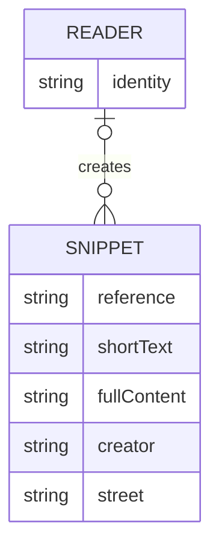

# Private snippet search

Readers discover their own snippets without revealing another reader's content or matching totals. The same restriction applies when repeating a search and after a saved edit becomes visible. This contract covers discovery privacy; authoring permissions, delivery mechanics and task lists have separate owners.

## Related Documentation

| Owner | Link | Read when |
|---|---|---|
| Test conventions | [Integration testing](../../project-reference/integration-test-reference.md) | Extending executable search guards |
| Search assertions | [Search tests](../../../src/Backend/PlatformExampleApp.IntegrationTests/TextSnippets/SearchSnippetTextQueryIntegrationTests.cs) | Tracing visible rows and totals |
| Repeated-search assertions | [Search isolation tests](../../../src/Backend/PlatformExampleApp.IntegrationTests/WebAppFactory/TextSnippetSearchCacheIsolationTests.cs) | Tracing different readers and saved edits |

## Contents

- [1. Overview](#1-overview)
- [2. Glossary](#2-glossary)
- [3. User Stories & Acceptance Criteria](#3-user-stories--acceptance-criteria)
- [4. Business Rules](#4-business-rules)
- [5. Domain Model](#5-domain-model)
- [6. Process Flows & Interaction Surface](#6-process-flows--interaction-surface)
- [7. Permissions & Roles](#7-permissions--roles)
- [8. Test Specifications](#8-test-specifications)
- [Change History](#change-history)

## 1. Overview

The discovery boundary returns matching snippets associated with the current reader. Search words, snippet reference and address restrictions further narrow that set; they never widen ownership. An unidentified reader may discover unowned snippets but cannot discover a named reader's private snippets.

The scope is an isolated correction to existing discovery behavior. No new role, ownership transfer, authoring workflow or visual layout is introduced. Existing list delivery mechanics are outside this business contract.

## 2. Glossary

| Term | Meaning |
|---|---|
| Reader | Person browsing snippets; their identity may be known or absent |
| Snippet | Saved short text and its full content, with an optional creator and address |
| Owned snippet | Snippet whose creator matches the current identified reader |
| Unowned snippet | Snippet with no creator |
| Match | Snippet satisfying ownership and every supplied search restriction |
| Total | Number of matching snippets before selecting the displayed portion |

Actor catalog: Reader. Identified and unidentified are states of this actor, not additional privileges.

## 3. User Stories & Acceptance Criteria

### US-SEARCH-01: Discover private content reliably

As a Reader, I want to find my matching snippets so that I can browse and revisit my saved content without exposing someone else's work.

- **AC-SEARCH-01:** Given snippets belonging to different readers, when a reader searches or refreshes after a successful saved edit, then only permitted matching snippets and their matching total are shown, with the saved content visible after deferred refresh completes; a foreign snippet or nonmatching restriction produces no result. Applies BR-SEARCH-01 and BR-SEARCH-02.

**Evidence:** `[Source: operation/text-snippet/PrivateSnippetSearch]`

## 4. Business Rules

### BR-SEARCH-01: Ownership constrains every match [HARD]

For ALL readers, search words, snippet references and supported address restrictions, every returned snippet must have the same creator as the current reader, and the total must count only those same matches. An absent reader identity matches only an absent creator. No restriction may restart discovery from a broader set. A foreign reference or mismatched address returns an empty result and zero total, without revealing whether a private snippet exists.

**Evidence:** `[Source: rule/text-snippet/SearchOwnership]`

### BR-SEARCH-02: Repeated discovery remains private and refreshable [HARD]

For ALL reader pairs and identical search restrictions, repeating one reader's search must not reuse another reader's private result. Results retained before this restriction was enforced must not expose private content to an unidentified reader. After an owner successfully saves an edit and deferred refresh completes, refreshing discovery shows the saved content. Brief older results while deferred refresh is pending are allowed; this example declares no fixed refresh latency promise.

**Evidence:** `[Source: rule/text-snippet/PrivateSearchRefresh]`

## 5. Domain Model



**Evidence:** `[Source: component/text-snippet/SearchableSnippet]`

The snippet is the saved source of truth. Discovery is read-only and introduces no lifecycle transition or new relationship. The creator is optional; the search boundary never changes it. Existing authoring rules govern edits.

## 6. Process Flows & Interaction Surface

### 6.1 Process flow

OP-SEARCH-01: Reader supplies search words and optional restrictions → ownership narrows the available snippets → remaining restrictions narrow the matches → reader receives matching content and total. Repeating the operation retains the same privacy boundary. A saved edit becomes visible after deferred refresh; an unsuccessful search changes no saved content.

**Evidence:** `[Source: operation/text-snippet/PrivateSnippetSearch]`

### 6.2 View inventory

The existing snippet browser shows search words, matching short text/full content and the total. Selecting a row opens its existing detail view. Editing belongs to the neighboring authoring capability; this contract adds no fields or controls.

### 6.3 Navigation map

Open snippet browser → enter or clear search words → inspect matches → optionally open a detail → return or refresh the browser. Changing search words restarts the displayed portion. Neighboring task browsing remains separate.

### 6.4 Observable states

Loading: a visible busy indication accompanies discovery. Populated: permitted matching content and total are displayed. Empty: no matching content and zero total are displayed. Error: the existing error message and refresh action permit another attempt; errors never justify displaying another reader's content. These are the four existing view states, not new business lifecycle states.

### 6.5 Story interaction flow

For US-SEARCH-01: (1) open the browser under the current reader identity, (2) enter search words or clear them, (3) wait for discovery, (4) inspect only permitted results and their total, (5) after a permitted edit succeeds, refresh until deferred refresh completes and observe saved content. BR-SEARCH-01/02 apply throughout. The example does not add an identity-entry screen.

## 7. Permissions & Roles

| Reader state | Matching content | Foreign private content | Saved edits |
|---|---|---|---|
| Identified Reader | Only snippets whose creator equals that reader | No rows and zero total | Governed by existing authoring rules; visible after deferred refresh |
| Unidentified Reader | Only unowned snippets | No rows and zero total | This read contract grants no edit privilege |

## 8. Test Specifications

The canonical business cases below link to their guarding assertions. Technical delivery, paging, serialization and transport guards remain outside this registry. Case status records observed execution of the linked guarding assertions; complete-suite verification is tracked separately.

| Category | P0 | P1 | Total |
|---|---|---|---|
| Preservation | 0 | 4 | 4 |
| Privacy and refresh | 4 | 0 | 4 |
| Invariant / Property | 1 | 0 | 1 |
| **Total** | **5** | **4** | **9** |

### Preservation Tests

#### TC-SEARCH-001: Empty words retain owned content [P1]

**Objective:** Verify that the owned snippet and a total of one are shown.
**Business Intent / Invariant Guarded:** BR-SEARCH-01; private discovery never changes who may see a snippet.
**Preconditions:** A reader with one owned snippet.
**Real-World Reachability:** Prior saved snippets carry creator associations; browsing does not create or change those associations. Association is owned by the trusted writer outside this discovery contract. Repeating a read can occur immediately and grants no new access.
**Demo Flow:**

```gherkin
Given a reader with one owned snippet
When the reader searches without words
Then the owned snippet and a total of one are shown
```

**Expected Result:** Displayed content and total satisfy the stated outcome; discovery changes no saved snippet. Loading/error presentation remains the existing browser behavior and is outside this assertion.
**Acceptance Criteria:** ✅ The owned snippet and a total of one are shown. ❌ Another reader's private content or matching count must never be exposed.
**Test Data:** an empty word sequence.
**Edge Cases:** Adding a foreign snippet must not add a match.
**Evidence:** `[Source: rule/text-snippet/SearchOwnership]`
**Related Behaviors:** US-SEARCH-01; AC-SEARCH-01; BR-SEARCH-01.
**CoveredBy:** TestSpec=TC-SEARCH-001
**Status:** Tested

#### TC-SEARCH-002: Matching words retain owned content [P1]

**Objective:** Verify that the owned snippet and a total of one are shown.
**Business Intent / Invariant Guarded:** BR-SEARCH-01; private discovery never changes who may see a snippet.
**Preconditions:** A reader with an owned searchable snippet.
**Real-World Reachability:** Prior saved snippets carry creator associations; browsing does not create or change those associations. Association is owned by the trusted writer outside this discovery contract. Repeating a read can occur immediately and grants no new access.
**Demo Flow:**

```gherkin
Given a reader with an owned searchable snippet
When the reader searches for its words after indexing settles
Then the owned snippet and a total of one are shown
```

**Expected Result:** Displayed content and total satisfy the stated outcome; discovery changes no saved snippet. Loading/error presentation remains the existing browser behavior and is outside this assertion.
**Acceptance Criteria:** ✅ The owned snippet and a total of one are shown. ❌ Another reader's private content or matching count must never be exposed.
**Test Data:** matching search words.
**Edge Cases:** Words that match no permitted snippet produce zero results.
**Evidence:** `[Source: rule/text-snippet/SearchOwnership]`
**Related Behaviors:** US-SEARCH-01; AC-SEARCH-01; BR-SEARCH-01.
**CoveredBy:** TestSpec=TC-SEARCH-002
**Status:** Tested

#### TC-SEARCH-003: Additional restrictions preserve a valid match [P1]

**Objective:** Verify that that snippet and a total of one are shown.
**Business Intent / Invariant Guarded:** BR-SEARCH-01; private discovery never changes who may see a snippet.
**Preconditions:** A reader with an owned snippet at a known street.
**Real-World Reachability:** Prior saved snippets carry creator associations; browsing does not create or change those associations. Association is owned by the trusted writer outside this discovery contract. Repeating a read can occur immediately and grants no new access.
**Demo Flow:**

```gherkin
Given a reader with an owned snippet at a known street
When the reader searches using its reference and matching street
Then that snippet and a total of one are shown
```

**Expected Result:** Displayed content and total satisfy the stated outcome; discovery changes no saved snippet. Loading/error presentation remains the existing browser behavior and is outside this assertion.
**Acceptance Criteria:** ✅ That snippet and a total of one are shown. ❌ Another reader's private content or matching count must never be exposed.
**Test Data:** an owned reference and its street.
**Edge Cases:** An absent optional restriction does not widen ownership.
**Evidence:** `[Source: rule/text-snippet/SearchOwnership]`
**Related Behaviors:** US-SEARCH-01; AC-SEARCH-01; BR-SEARCH-01.
**CoveredBy:** TestSpec=TC-SEARCH-003
**Status:** Tested

#### TC-SEARCH-004: No match reveals no content [P1]

**Objective:** Verify that no snippets and zero total are shown.
**Business Intent / Invariant Guarded:** BR-SEARCH-01; private discovery never changes who may see a snippet.
**Preconditions:** A reader with saved snippets.
**Real-World Reachability:** Prior saved snippets carry creator associations; browsing does not create or change those associations. Association is owned by the trusted writer outside this discovery contract. Repeating a read can occur immediately and grants no new access.
**Demo Flow:**

```gherkin
Given a reader with saved snippets
When the reader searches for a nonexistent reference
Then no snippets and zero total are shown
```

**Expected Result:** Displayed content and total satisfy the stated outcome; discovery changes no saved snippet. Loading/error presentation remains the existing browser behavior and is outside this assertion.
**Acceptance Criteria:** ✅ No snippets and zero total are shown. ❌ Another reader's private content or matching count must never be exposed.
**Test Data:** a fresh nonexistent reference.
**Edge Cases:** An existing foreign reference also produces zero results.
**Evidence:** `[Source: rule/text-snippet/SearchOwnership]`
**Related Behaviors:** US-SEARCH-01; AC-SEARCH-01; BR-SEARCH-01.
**CoveredBy:** TestSpec=TC-SEARCH-004
**Status:** Tested

### Privacy and refresh Tests

#### TC-SEARCH-021: A different reader cannot discover private content [P0]

**Objective:** Verify that no private content and zero total are shown.
**Business Intent / Invariant Guarded:** BR-SEARCH-01; private discovery never changes who may see a snippet.
**Preconditions:** Two different readers and a snippet owned by the first.
**Real-World Reachability:** Prior saved snippets carry creator associations; browsing does not create or change those associations. Association is owned by the trusted writer outside this discovery contract. Repeating a read can occur immediately and grants no new access.
**Demo Flow:**

```gherkin
Given two different readers and a snippet owned by the first
When the second searches for the private reference
Then no private content and zero total are shown
```

**Expected Result:** Displayed content and total satisfy the stated outcome; discovery changes no saved snippet. Loading/error presentation remains the existing browser behavior and is outside this assertion.
**Acceptance Criteria:** ✅ No private content and zero total are shown. ❌ Another reader's private content or matching count must never be exposed.
**Test Data:** two different reader identities.
**Edge Cases:** Identical search restrictions do not confer ownership.
**Evidence:** `[Source: rule/text-snippet/SearchOwnership]`
**Related Behaviors:** US-SEARCH-01; AC-SEARCH-01; BR-SEARCH-01.
**CoveredBy:** TestSpec=TC-SEARCH-021
**Status:** Tested

#### TC-SEARCH-022: Repeated searches do not reveal another reader [P0]

**Objective:** Verify that both see no private rows and zero total.
**Business Intent / Invariant Guarded:** BR-SEARCH-02; private discovery never changes who may see a snippet.
**Preconditions:** One reader has just searched private content and older shared results may exist.
**Real-World Reachability:** Prior saved snippets carry creator associations; browsing does not create or change those associations. Association is owned by the trusted writer outside this discovery contract. Repeating a read can occur immediately and grants no new access.
**Demo Flow:**

```gherkin
Given one reader has just searched private content and older shared results may exist
When another reader and an unidentified reader repeat the same search
Then both see no private rows and zero total
```

**Expected Result:** Displayed content and total satisfy the stated outcome; discovery changes no saved snippet. Loading/error presentation remains the existing browser behavior and is outside this assertion.
**Acceptance Criteria:** ✅ Both see no private rows and zero total. ❌ Another reader's private content or matching count must never be exposed.
**Test Data:** identified readers and an unidentified reader with identical restrictions.
**Edge Cases:** A supplied untrusted identity hint does not grant ownership.
**Evidence:** `[Source: rule/text-snippet/PrivateSearchRefresh]`
**Related Behaviors:** US-SEARCH-01; AC-SEARCH-01; BR-SEARCH-02.
**CoveredBy:** TestSpec=TC-SEARCH-022
**Status:** Tested

```yaml
inputDomain: "any two different readers, an unidentified reader and identical valid search restrictions with a prior retained private result"
invariant: "for ALL reader pairs, repeated discovery never reveals content belonging to the other reader"
boundaryCounterCase: "an unidentified reader repeating a previously private search receives no private rows or matching count"
```

#### TC-SEARCH-023: Saved private edits become visible to their owner [P0]

**Objective:** Verify that the owner sees the saved content while another reader still sees no private content.
**Business Intent / Invariant Guarded:** BR-SEARCH-02; private discovery never changes who may see a snippet.
**Preconditions:** An owner has already searched an owned snippet.
**Real-World Reachability:** Prior saved snippets carry creator associations; browsing does not create or change those associations. Association is owned by the trusted writer outside this discovery contract. Repeating a read can occur immediately and grants no new access.
**Demo Flow:**

```gherkin
Given an owner has already searched an owned snippet
When the owner saves changed content successfully and refreshes after deferred refresh settles
Then the owner sees the saved content while another reader still sees no private content
```

**Expected Result:** Displayed content and total satisfy the stated outcome; discovery changes no saved snippet. Loading/error presentation remains the existing browser behavior and is outside this assertion.
**Acceptance Criteria:** ✅ The owner sees the saved content while another reader still sees no private content. ❌ Another reader's private content or matching count must never be exposed.
**Test Data:** one owned snippet with changed full content.
**Edge Cases:** An older retained result may remain only while refresh is pending.
**Evidence:** `[Source: rule/text-snippet/PrivateSearchRefresh]`
**Related Behaviors:** US-SEARCH-01; AC-SEARCH-01; BR-SEARCH-02.
**CoveredBy:** TestSpec=TC-SEARCH-023
**Status:** Tested

```yaml
inputDomain: "any permitted owner edit to full content followed by settled deferred refresh"
invariant: "for ALL permitted edits, the owner can observe the saved content after refresh without another reader gaining access"
boundaryCounterCase: "a different reader refreshing the same private reference still receives no rows or matching count"
```

#### TC-SEARCH-024: A nonmatching restriction does not reveal content [P0]

**Objective:** Verify that no rows and zero total are shown.
**Business Intent / Invariant Guarded:** BR-SEARCH-01; private discovery never changes who may see a snippet.
**Preconditions:** A reader has an owned snippet at a known street.
**Real-World Reachability:** Prior saved snippets carry creator associations; browsing does not create or change those associations. Association is owned by the trusted writer outside this discovery contract. Repeating a read can occur immediately and grants no new access.
**Demo Flow:**

```gherkin
Given a reader has an owned snippet at a known street
When the reader submits its reference with a different street
Then no rows and zero total are shown
```

**Expected Result:** Displayed content and total satisfy the stated outcome; discovery changes no saved snippet. Loading/error presentation remains the existing browser behavior and is outside this assertion.
**Acceptance Criteria:** ✅ No rows and zero total are shown. ❌ Another reader's private content or matching count must never be exposed.
**Test Data:** an owned reference with a nonmatching street.
**Edge Cases:** Ownership does not override an additional restriction.
**Evidence:** `[Source: rule/text-snippet/SearchOwnership]`
**Related Behaviors:** US-SEARCH-01; AC-SEARCH-01; BR-SEARCH-01.
**CoveredBy:** TestSpec=TC-SEARCH-024
**Status:** Tested

### Invariant / Property Tests

#### TC-SEARCH-071: Every text branch preserves ownership and totals [P0]

**Objective:** Verify that every result and total is limited to that reader's matching snippets.
**Business Intent / Invariant Guarded:** BR-SEARCH-01; private discovery never changes who may see a snippet.
**Preconditions:** Two readers have matching words in different owned snippets.
**Real-World Reachability:** Prior saved snippets carry creator associations; browsing does not create or change those associations. Association is owned by the trusted writer outside this discovery contract. Repeating a read can occur immediately and grants no new access.
**Demo Flow:**

```gherkin
Given two readers have matching words in different owned snippets
When each searches with and without words and with supported reference/street restrictions
Then every result and total is limited to that reader's matching snippets
```

**Expected Result:** Displayed content and total satisfy the stated outcome; discovery changes no saved snippet. Loading/error presentation remains the existing browser behavior and is outside this assertion.
**Acceptance Criteria:** ✅ Every result and total is limited to that reader's matching snippets. ❌ Another reader's private content or matching count must never be exposed.
**Test Data:** all current reader states and supported combinations of words/reference/street restrictions.
**Edge Cases:** A foreign reference under either text branch returns no rows and zero total.
**Evidence:** `[Source: rule/text-snippet/SearchOwnership]`
**Related Behaviors:** US-SEARCH-01; AC-SEARCH-01; BR-SEARCH-01.
**CoveredBy:** TestSpec=TC-SEARCH-071
**Status:** Tested

```yaml
inputDomain: "all current readers, empty/nonempty words, optional snippet references and supported street restrictions"
invariant: "for ALL inputs, returned snippets have the current reader as creator and totals count only those same matches"
boundaryCounterCase: "a foreign snippet reference, including under nonempty words, yields no rows and zero total"
```

## Change History

- 2026-10-17: Initialized the existing private-discovery contract and regression cases during authorized review repair. Public list mechanics remain technical contracts. No ownership transfer or new editing behavior is introduced.
